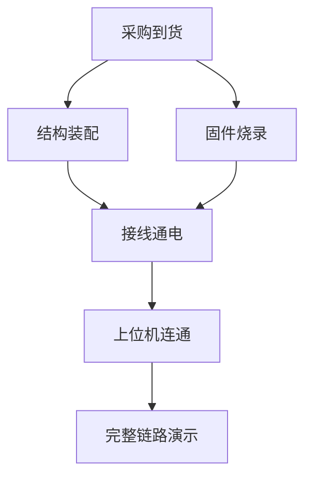

# 六维拆解总表（{{PROJECT_NAME}}）

| 字段 | 值 |
|---|---|
| 适用版本 | __ |
| 最后更新 | {{DATE}} |
| 前置条件 | 读完 `00-总纲与路线图.md` |

## 1. 六维总表

| 维度 | 是什么 / 包含什么 | 买什么（MVP 部分） | 谁做 | 门槛（最难三步） | 降级路径（可外包/买成品） | 实现路径（买成品/代做/自制 + 参数） | 卡点 |
|---|---|---|---|---|---|---|---|
| ① 硬件电子 | __ | __ | 家长 L2 / 孩子 L1 | __ | __ | __ | __ |
| ② 结构外壳 | __ | __ | __ | __ | __ | __ | __ |
| ③ 固件 | __ | __ | __ | __ | __ | __ | __ |
| ④ 上位机软件 | __ | __ | __ | __ | __ | __ | __ |
| ⑤ 算法代码 | __ | __ | __ | __ | __ | __ | __ |
| ⑥ 资料与生态 | __ | __ | __ | __ | __ | __ | __ |

> 采购明细与参考价见 `05-安全与工具采购清单.md`；打样/代做参数（层数、板厚、材料、填充、公差）与下单渠道见 skill 的 `references/可实现路径与外包.md`；工程参数以 `projects/{{PROJECT_SLUG}}/docs/` 为准。

## 2. 依赖关系

关键路径：__（说明哪条链最长、最容易卡）

## 3. 家长技能矩阵（本项目实际需要）

| 技能 | 本项目是否需要 | 用在哪一步 | 零基础替代方案 |
|---|---|---|---|
| 焊接 | 需要 / 不需要 | __ | __ |
| 烧录固件 | __ | __ | __ |
| 命令行 | __ | __ | __ |
| 3D 打印 | __ | __ | __ |
| 金属加工 | __ | __ | __ |
| 调试排错 | **必须**（无法外包） | 全程 | 按 `04-验收与展示.md` 的排查顺序做 |

## 4. Top 卡点清单（提前预防）

| # | 卡点 | 现象 | 预防手段 | 出现后先查什么 |
|---|---|---|---|---|
| 1 | __ | __ | __ | __ |
| 2 | __ | __ | __ | __ |
| 3 | __ | __ | __ | __ |

## 5. 与工程文档的对应关系

| 本手册章节 | 对应工程文档 |
|---|---|
| ① 硬件电子 | `projects/{{PROJECT_SLUG}}/hardware/` |
| ② 结构外壳 | `projects/{{PROJECT_SLUG}}/enclosure/` |
| ③ 固件 | `projects/{{PROJECT_SLUG}}/firmware/` |
| ④ 上位机软件 | `projects/{{PROJECT_SLUG}}/software/` |
| ⑤ 算法代码 | `projects/{{PROJECT_SLUG}}/code/` |
| ⑥ 资料与生态 | `projects/{{PROJECT_SLUG}}/docs/99-参考资源.md` |
