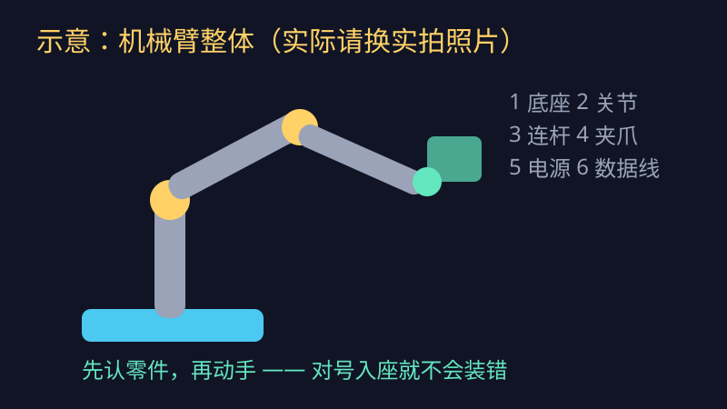
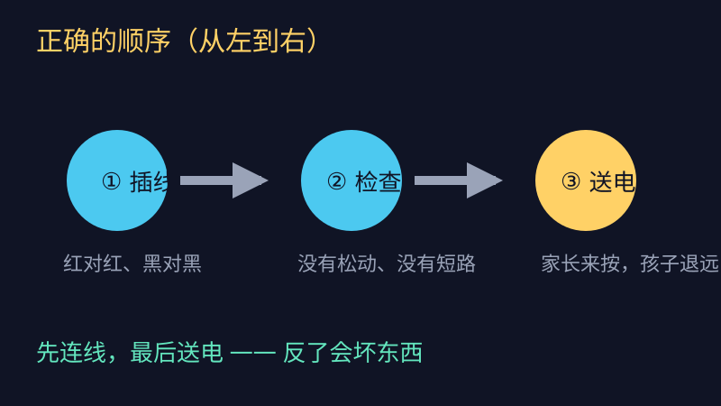
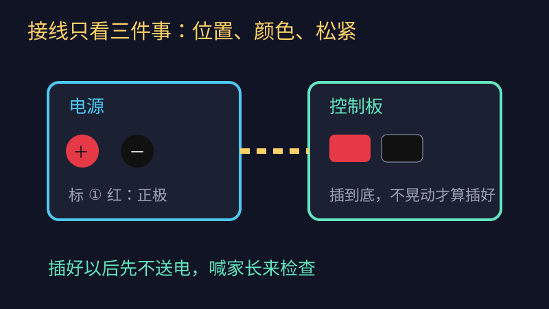

<!--
示例课件（仓库根目录执行，可直接构建看效果；已附构建好的 示例-第一课.html，浏览器打开即可放映）：
python3 .trae/skills/stem-project-onboarding/scripts/build_slides.py .trae/skills/stem-project-onboarding/assets/课件模板/示例-第一课.md
说明：正文按 reBot-DevArm 机械臂举例，图是示意 SVG，实际使用时换成项目实拍照片。
-->

<!-- layout: title -->
# 机械臂 · 第 1 课

今天只做一件事：让它通电、认得我
<!-- notes: 开场 30 秒。只说今天要做的事，不讲原理，不预告难点。 -->

---
<!-- layout: image -->
## 先看，不许说话

<!-- notes: 给孩子看 10 秒，然后问"你看到了什么"。孩子说错也不纠正，记在纸上留到最后对照。 -->

---
<!-- layout: big -->
## 猜一猜
先插线，还是先送电？
<!-- notes: 等 10 秒再给线索。正确答案是"先插线、最后送电"，但要让孩子自己得出。 -->

---
## 动手（3 步）
1. 把贴 ① 的线插到电源口
2. 确认红对红、黑对黑
3. 喊我：我来送电

<!-- notes: 孩子只做前三步；送电由家长执行，孩子退到一臂之外。若有异味/异响立即断电。 -->

---
<!-- layout: big -->
## 通关条件
板上灯亮 = 过关
<!-- notes: 让孩子自己判断。过了就盖章；没过就一起找第一条线索，不批评。 -->

---
<!-- layout: two-col -->
### 我们发现的
- 灯亮了
- 风扇有"嘘——"的声音
### 记下的线索
- 第一次没亮：开关没按到底
<!-- notes: 收尾 3 问。把线索写进线索本，下一课时第一件事就是查它。 -->

---
<!-- layout: big -->
## 小心
手不碰关节，它断电会掉
<!-- notes: 讲安全时只说这一句，然后让孩子复述一遍："手不碰哪里？" -->

---
<!-- layout: title -->
# 恭喜过关
你已经是「接线员」了
<!-- notes: 盖章、发称号，预告下一关：让一个关节听口令转起来。 -->
