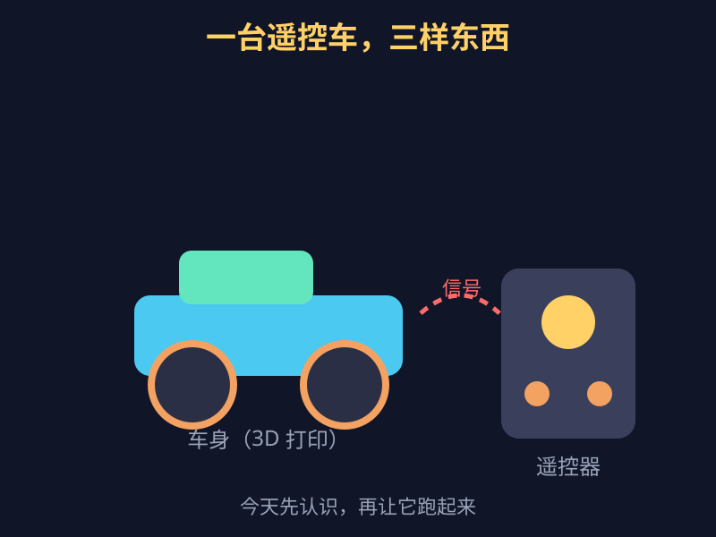
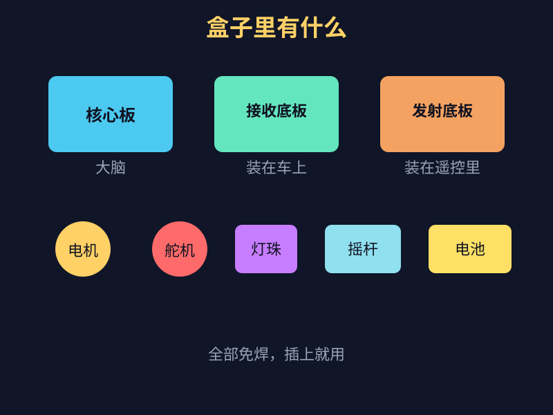
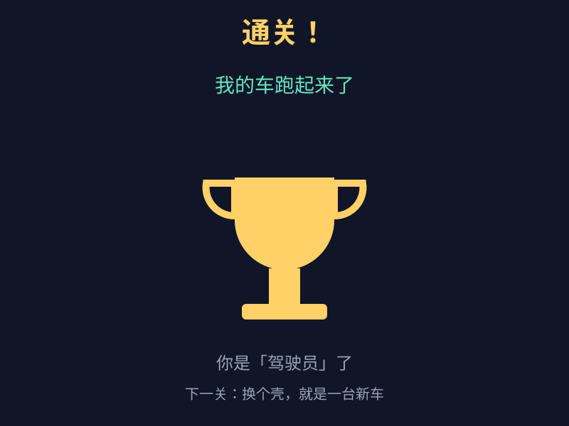

<!--
第 1 课 · 认识我们的套件（对应里程碑 M0）
规则：一页一件事、一页 ≤15 字、每页有图位、每页写讲者备注。
页面顺序：封面 → 看一眼 → 猜一猜 → 动手 → 通关条件 → 发现与线索 → 庆祝+预告。
-->

<!-- layout: title -->
# 拓竹 CyberBrick · 第 1 课

今天我们要做一台会跑的车
<!-- notes: 开场 30 秒，只说今天要做的事，不讲原理。 -->

---
<!-- layout: image -->
## 先看盒子里有什么

<!-- notes: 给孩子看 10 秒，问"你看到了什么"，不提示、不补充。 -->

---
<!-- layout: big -->
## 猜一猜
哪一块是它的大脑？
<!-- notes: 让孩子先猜再动手。答案不写在这页；答错就说"那我们打开看看"。 -->

---
## 动手（3 步）
1. 零件分格
2. 贴上名字
3. 找出大脑和电池

<!-- notes: 一次只做这一件事。分格是为了后面不丢零件。 -->

---
<!-- layout: big -->
## 通关条件
零件分好格，能说出哪块是大脑
<!-- notes: 让孩子自己判断过没过。家长不评价快慢。过关就盖章。 -->

---
<!-- layout: two-col -->
### 我们发现的
- 零件都是插头的
- 不用焊，不用螺丝刀拧电路
### 记下的线索
- 核心板 = 大脑
- 底板 = 装在车和遥控里的插座板
<!-- notes: 收尾 3 问：今天成功的标志是什么 / 哪里最麻烦 / 下次想改哪里。 -->

---
<!-- layout: title -->
# 恭喜过关
你现在是「材料员」了

<!-- notes: 盖章、发称号，预告下一关：让打印机吐出我们的零件。留个钩子再下课。 -->
