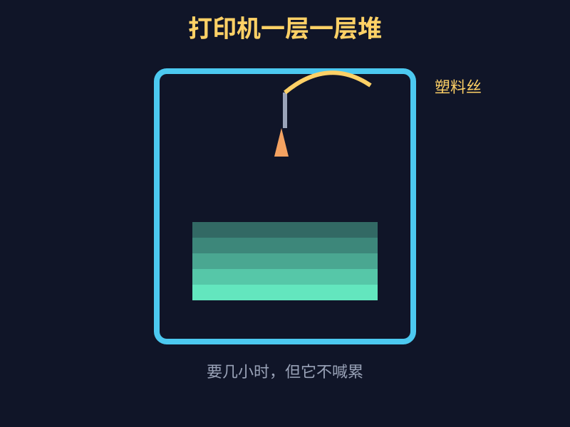

<!--
第 2 课 · 让打印机吐出我的零件（对应里程碑 M1）
规则：一页一件事、一页 ≤15 字、每页有图位、每页写讲者备注。
-->

<!-- layout: title -->
# 拓竹 CyberBrick · 第 2 课

让打印机吐出我的零件
<!-- notes: 开场 30 秒：今天车壳是我们自己"做"出来的。 -->

---
<!-- layout: image -->
## 先看一样东西

<!-- notes: 先看 10 秒，问"它是怎么把零件做出来的"，不提示。 -->

---
<!-- layout: big -->
## 猜一猜
要打印几个小时？
<!-- notes: 让孩子先猜再去看切片软件的时间。答案不写在页面上。 -->

---
## 动手（3 步）
1. 挑一辆车
2. 用官方配置
3. 按开始打印

<!-- notes: 关键提醒：不要自己改缩放。打印机是机器时间，可以过夜。 -->

---
<!-- layout: big -->
## 通关条件
零件到齐，车轮能手动转
<!-- notes: 打印完先剪支撑、去毛刺再装。断裂就换好一点的料重打。 -->

---
<!-- layout: two-col -->
### 我们发现的
- 打印机是一层层堆出来的
- 手推一边轮子，另一边反向转
### 记下的线索
- 活动件要用 PLA Basic / PETG
- 不用最脆的那种料
<!-- notes: 收尾 3 问。差速器的原理看知识卡 K09。 -->

---
<!-- layout: title -->
# 恭喜过关
你现在是「装配员」了

<!-- notes: 盖章。预告下一关：第一次通电，看灯跟我们说话。 -->
