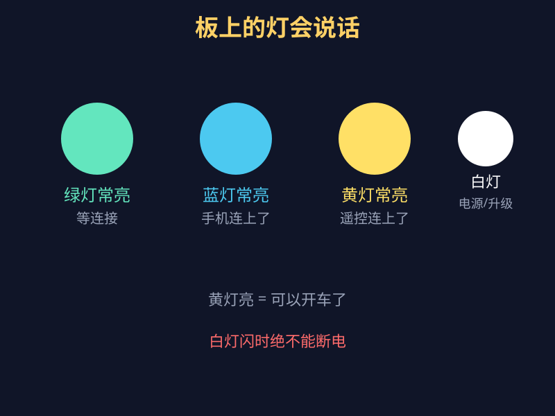
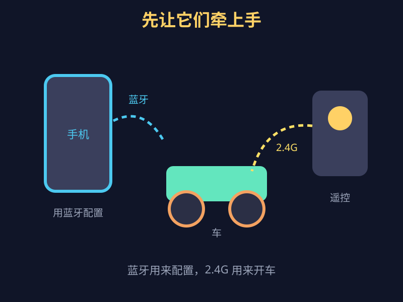
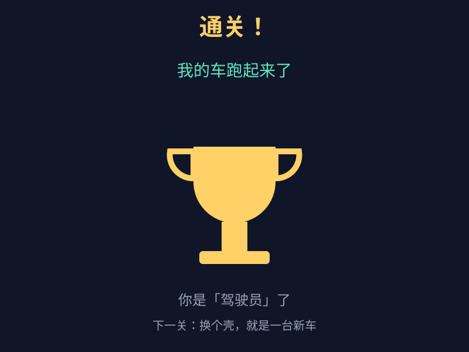

<!--
第 3 课 · 第一次通电：灯在跟我说话（对应里程碑 M2）
规则：一页一件事、一页 ≤15 字、每页有图位、每页写讲者备注。
-->

<!-- layout: title -->
# 拓竹 CyberBrick · 第 3 课

第一次通电：灯在跟我说话
<!-- notes: 开场 30 秒：今天只做一件事——让它亮起来、连上手机。 -->

---
<!-- layout: image -->
## 先看一样东西

<!-- notes: 先看 10 秒，问"灯有几种颜色"，不提示。 -->

---
<!-- layout: big -->
## 猜一猜
灯为什么会变颜色？
<!-- notes: 让孩子先猜。不同颜色 = 不同状态，这就是"灯语"。 -->

---
## 动手（3 步）
1. 核对电池方向
2. 清空再送电
3. 手机连上它

<!-- notes: 送电由家长执行，孩子在安全距离外。一块板只能连一个手机。 -->

---
<!-- layout: big -->
## 通关条件
黄灯常亮 = 遥控连上了
<!-- notes: 白灯亮=电源正常；绿灯=待连接；蓝灯=蓝牙连上；黄灯=遥控连上。 -->

---
<!-- layout: two-col -->
### 我们发现的
- 白灯亮＝有电
- 蓝灯亮＝手机连上
- 黄灯亮＝遥控连上
### 记下的线索
- 搜不到先断开别的手机
- 白灯闪时不能断电
<!-- notes: 收尾 3 问。灯语表见 docs/03-组装与调试.md。 -->

---
<!-- layout: title -->
# 恭喜过关
你现在是「接线员」了

<!-- notes: 盖章。预告下一关：我推一下，它就跑。 -->
