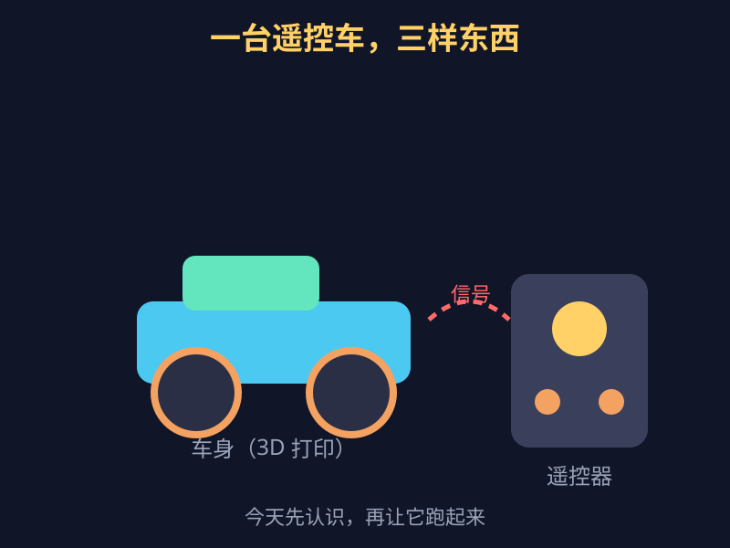
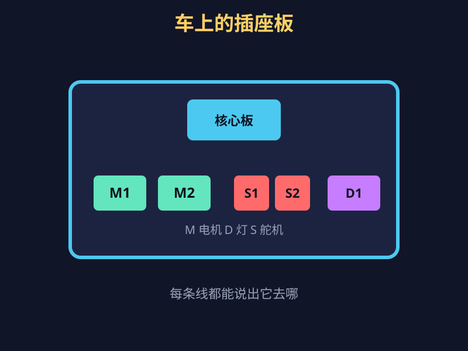

<!--
第 4 课 · 我推一下，它就跑（对应里程碑 M3，MVP 收官）
规则：一页一件事、一页 ≤15 字、每页有图位、每页写讲者备注。最后一页必须是通关庆祝页。
-->

<!-- layout: title -->
# 拓竹 CyberBrick · 第 4 课

我推一下，它就跑
<!-- notes: 开场 30 秒：今天是 MVP 最后一关，跑完这圈你就有一台真的车。 -->

---
<!-- layout: image -->
## 先看一样东西

<!-- notes: 先看 10 秒，让孩子用手指点一遍：M1、M2、S1、D1、电源。 -->

---
<!-- layout: big -->
## 猜一猜
推摇杆，命令怎么走到车轮？
<!-- notes: 让孩子先说顺序：摇杆 → 遥控发射 → 2.4G → 车接收 → 电机转。 -->

---
## 动手（3 步）
1. 对表核对接线
2. 清空 2 米场地
3. 轻轻推摇杆

<!-- notes: 先小幅度试方向，再跑整圈。方向反了就断电对调那两根线。 -->

---
<!-- layout: big -->
## 通关条件
车按摇杆跑完一圈
<!-- notes: 录一段 ≤10 秒视频存档。连续 2 次成功即算通过。 -->

---
<!-- layout: two-col -->
### 我们发现的
- 一个轮转一个不转，多数是插头
- 方向反了，对调电机两根线
### 记下的线索
- 手离开车轮才能碰摇杆
- 发烫、异响立即断电
<!-- notes: 收尾 3 问。安全一票否决项见 docs/05-教学与课程.md。 -->

---
<!-- layout: title -->
# 恭喜过关
你现在是「驾驶员」了

<!-- notes: 盖章、发称号。预告下一关：改一个数字、换个壳，就是一台新车。 -->
