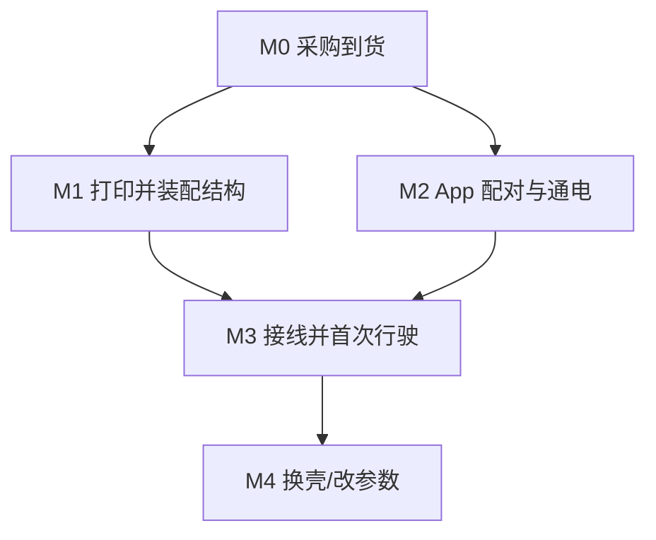

# 六维拆解总表（拓竹 CyberBrick 模块化遥控套件）

| 字段 | 值 |
|---|---|
| 适用版本 | 硬件：入门套件 ZK004 + 一个 MakerWorld 免费车模　／　软件：CyberBrick App |
| 最后更新 | 2026-10-20 |
| 前置条件 | 读完 `00-总纲与路线图.md` |

## 1. 六维总表

| 维度 | 是什么 / 包含什么 | 买什么（MVP 部分） | 谁做 | 门槛（最难三步） | 降级路径 | 实现路径（买/代做/自制 + 参数） | 卡点 |
|---|---|---|---|---|---|---|---|
| ① 硬件电子 | 核心板 XA003、发射底板 XA005、接收底板 XA004、电机/舵机/灯/电池等免焊模块 | 入门套件 ZK004（含全部电子件） | 家长 L2 / 孩子 L1 | ①认清底板每个插口 ②电池插头方向 ③充电器别用错 | 无需降级：模块全部免焊、出厂已组装 | 直接买 ZK004；坏了单买对应模块（官方配件页） | 用手机快充头充电（官方禁止）、插口插反 |
| ② 结构外壳 | 车身/悬挂/车轮等 3D 打印件，模型来自 MakerWorld | 1 kg PLA Basic 或 PETG | 家长操作打印机 / 孩子点件（L2） | ①会不会用打印机 ②选对耗材 ③去支撑毛刺 | 无打印机 → 嘉立创/淘宝代打，按克计价 | 模型页下 3MF/STL → 按官方配置打印；活动件用 PLA Basic/PETG，**不用 PLA Lite** | 缩放或自换参数导致装配不上、活动件断裂 |
| ③ 固件 | 核心板出厂固件 + App 内蓝牙升级 | 无需单独买 | 家长（孩子看） | 只需会点 App 里的"升级" | 不升级也能玩 | App 内一键升级；白灯闪时**绝不能断电** | 升级中断电、用第三方工具刷写（官方不支持） |
| ④ 上位机软件 | CyberBrick App（手机/PC）：配对、绑通道、下载现成遥控工程 | 免费下载 | 家长 L2 / 孩子 L3 | ①手机蓝牙配对 ②绑 2.4G 主从 ③同步配置 | 无需降级 | 应用商店或官方下载页装 App；模型页下配置 JSON → App 同步 | 一块板只能连一个蓝牙主机，需先断开别的设备 |
| ⑤ 算法代码 | App 图形化（比例控制/混控/事件）→ MicroPython 进阶 | 免费 | 孩子 L3 | ①App 里找到调参入口 ②改一个数字 ③MicroPython 环境 | MicroPython 装不上 → 只做 App 调参（MVP 足够） | App 内拖滑块起步；进阶装 Thonny 连 Type-C 数据线 | `boot.py` 是"开机跑一遍"，不是死循环 |
| ⑥ 资料与生态 | 官方 Wiki + MakerWorld 模型库 + 官方代码库 + 社区帖 | 免费 | 家长 | ①找到对应模型的 BOM/组装 PDF ②看清模型许可 | 只用官方 Wiki + 官方模型 | 见 `docs/99-参考资源.md`（全部标访问日期） | 模型页"另需"件没提前买，装到一半缺件 |

> 采购明细与参考价见 `05-安全与工具采购清单.md`；工程参数以 `projects/cyberbrick/docs/` 为准。

## 2. 依赖关系

关键路径：**M1 打印**最长也最不可控——打印是机器时间（8–13 小时）+ 可能失败重打。其余环节都是"坐下来就能推进"的。所以**一确定选型就先把打印任务排上**，打印期间同步做 M0 的核对与 M2 的 App 安装。

## 3. 家长技能矩阵（本项目实际需要）

| 技能 | 本项目是否需要 | 用在哪一步 | 零基础替代方案 |
|---|---|---|---|
| 焊接 | **不需要** | — | 模块免焊插接 |
| 烧录固件 | **不需要** | 只在 App 里点升级 | 出厂已烧好，可直接玩 |
| 命令行 | **不需要**（进阶才用） | 仅 MicroPython 进阶线 | MVP 全程 App 图形化 |
| 3D 打印 | **需要** | M1 打印结构件 | 代打（按克计价），或先只打最小件 |
| 金属加工 | 不需要 | — | — |
| 调试排错 | **必须**（无法外包） | 全程 | 按 `04-验收与展示.md` 的排查顺序做；先看灯语 |

## 4. Top 卡点清单（提前预防）

| # | 卡点 | 现象 | 预防手段 | 出现后先查什么 |
|---|---|---|---|---|
| 1 | 打印失败/变形 | 翘边、断层、装配不上 | 用官方推荐配置与耗材；活动件不用 PLA Lite | 是否改过缩放/参数；是否耗材受潮 |
| 2 | 遥控连不上 | 推摇杆没反应 | 先看灯语：**黄色常亮**才是 2.4G 主从已连 | 核心板灯语表（`docs/03-组装与调试.md`） |
| 3 | App 搜不到设备 | 手机蓝牙列表没设备 | 一块板同时只连一个蓝牙主机 | 先断开另一台手机/平板上的 App |
| 4 | 充电发烫/损坏 | 充电时外壳发热 | **只用 5V 1–2A**，不用手机快充头 | 充电器是否为官方 7.4V XH2.54 款 |
| 5 | 方向反了 | 前进变后退、左转变右转 | 首次行驶前先小幅度试 | 断电对调该电机两根线，或在 App 里反向该通道 |

## 5. 与工程文档的对应关系

| 本手册章节 | 对应工程文档 |
|---|---|
| ① 硬件电子 | `projects/cyberbrick/hardware/` |
| ② 结构外壳 | `projects/cyberbrick/enclosure/` |
| ③ 固件 | `projects/cyberbrick/firmware/` |
| ④ 上位机软件 | `projects/cyberbrick/software/` |
| ⑤ 算法代码 | `projects/cyberbrick/code/` |
| ⑥ 资料与生态 | `projects/cyberbrick/docs/99-参考资源.md` |
