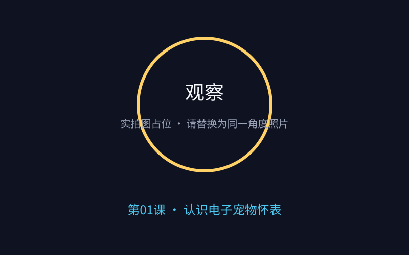

# 知识卡 · 主控（代号贴纸：K06-01）

> 打印建议：A5 横向 / 一页两卡对折；正面给孩子看（大字 + 图），背面给家长看。

## 正面（给孩子看）

### ① 看到什么
这块板子上有屏幕、麦克风、喇叭，它们都听一个“小队长”指挥。

### ② 先猜
谁在指挥它们？

- A. 屏幕
- B. 主控

### ③ 动手验证（家里就能做，5 分钟）

1. 找一块旧遥控器或玩具，打开电池盖
2. 找到里面最大的黑色方块（芯片）
3. 你看到 一块有很多脚的黑色小方块

### ④ 它叫什么

- 外号：小队长
- 正式名：**主控芯片（MCU）**
- 一句话：像乐队指挥，自己不唱，但让所有人一起演奏

### ⑤ 还在哪见过

- 家里：遥控器、玩具车、洗衣机
- 外面：红绿灯、电梯按钮、共享单车锁

---

## 背面（给家长看）

| 项 | 内容 |
|---|---|
| 这张卡想让孩子明白 | 知道设备里有一个负责发号施令的小电脑 |
| ② 的引导 | 等 10 秒再给线索；答错就说“那我们试试看” |
| ③ 的预期结果 | 找到黑色芯片；找不到就看电路板中央最大的方块 |
| 适合档位 | L1 说现象 / L2 换一个变量再试 / L3 讲给家人听 |
| 常见误解 | 以为屏幕就是大脑；实际屏幕只是脸，主控才是大脑 |
| 延伸追问 | 1）主控在哪里？ 2）它管什么？ 3）没有它会怎样？ |
| 线索记录 | 日期 __ ／ 现象 __ ／ 结论 __ |

> 集卡规则：本卡盖 1 枚章；同一主题集满 3 张发称号「小队长」。
