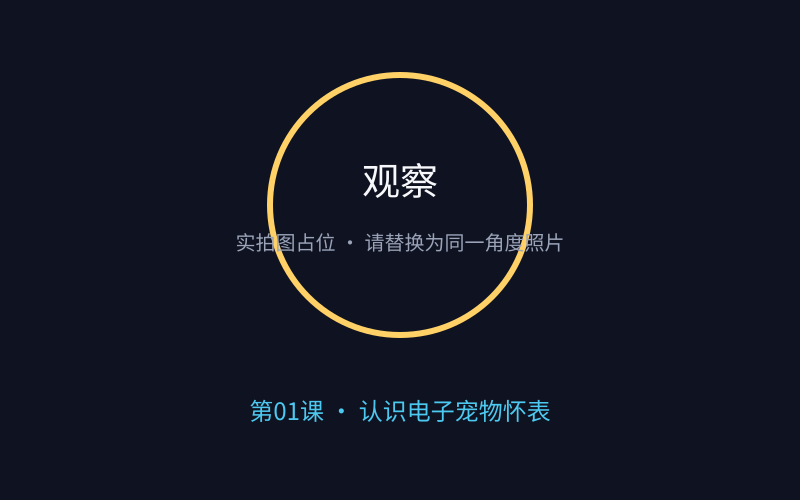

# 知识卡 · 电池（代号贴纸：K06-02）

> 打印建议：A5 横向 / 一页两卡对折；正面给孩子看（大字 + 图），背面给家长看。

## 正面（给孩子看）

### ① 看到什么
拔掉 USB，怀表还能亮，是因为里面藏着一块电池。

### ② 先猜
电池给谁供电？

- A. 只给屏幕
- B. 给整块板

### ③ 动手验证（家里就能做，5 分钟）

1. 找一个用电池的玩具
2. 把其中一节电池反着装
3. 你看到 玩具不工作或不动

### ④ 它叫什么

- 外号：能量包
- 正式名：**锂电池**
- 一句话：像水壶，给整台机器供水

### ⑤ 还在哪见过

- 家里：遥控器、手电筒、玩具
- 外面：充电宝、电动车、手机

---

## 背面（给家长看）

| 项 | 内容 |
|---|---|
| 这张卡想让孩子明白 | 知道电池给整块板供电，正负极不能反 |
| ② 的引导 | 等 10 秒再给线索；答错就说“那我们试试看” |
| ③ 的预期结果 | 反装电池玩具不动；正装后恢复 |
| 适合档位 | L1 说现象 / L2 换一个变量再试 / L3 讲给家人听 |
| 常见误解 | 以为电池只给屏幕；实际给主控、屏幕、喇叭全部 |
| 延伸追问 | 1）电池装反会怎样？ 2）为什么不能用快充头？ 3）鼓包了怎么办？ |
| 线索记录 | 日期 __ ／ 现象 __ ／ 结论 __ |

> 集卡规则：本卡盖 1 枚章；同一主题集满 3 张发称号「能量员」。
