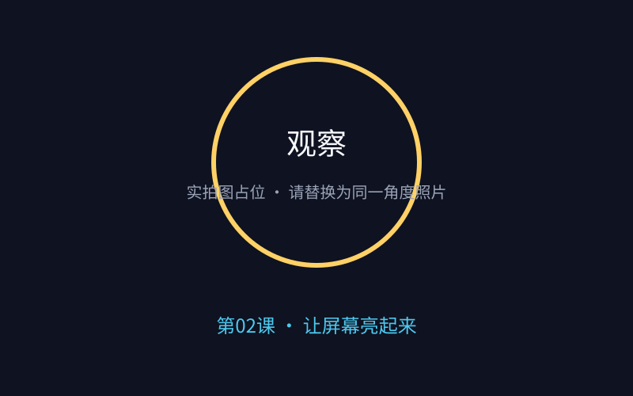

# 知识卡 · 屏幕（代号贴纸：K06-03）

> 打印建议：A5 横向 / 一页两卡对折；正面给孩子看（大字 + 图），背面给家长看。

## 正面（给孩子看）

### ① 看到什么
屏幕上有时间、表情和字幕，凑近看是一个个小点。

### ② 先猜
屏幕为什么能显示字？

- A. 里面有小灯泡
- B. 像素点变色

### ③ 动手验证（家里就能做，5 分钟）

1. 用放大镜看手机屏幕
2. 换不同颜色的画面
3. 你看到 一排排小点

### ④ 它叫什么

- 外号：脸
- 正式名：**像素**
- 一句话：像马赛克拼图，小格子拼出大图

### ⑤ 还在哪见过

- 家里：手机、电视、手表
- 外面：广告屏、地铁显示屏

---

## 背面（给家长看）

| 项 | 内容 |
|---|---|
| 这张卡想让孩子明白 | 知道画面由像素点组成 |
| ② 的引导 | 等 10 秒再给线索；答错就说“那我们试试看” |
| ③ 的预期结果 | 放大镜能看到格子；看不到就调亮屏幕 |
| 适合档位 | L1 说现象 / L2 换一个变量再试 / L3 讲给家人听 |
| 常见误解 | 以为屏幕是一张会变的纸；实际是很多小灯 |
| 延伸追问 | 1）像素是什么？ 2）圆屏也是方像素吗？ 3）屏幕坏了会怎样？ |
| 线索记录 | 日期 __ ／ 现象 __ ／ 结论 __ |

> 集卡规则：本卡盖 1 枚章；同一主题集满 3 张发称号「像素员」。
