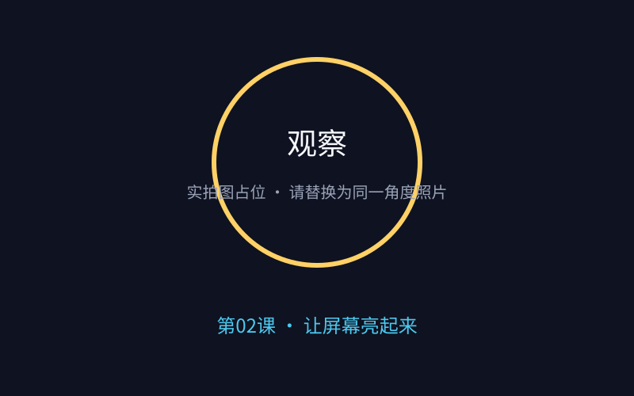

# 知识卡 · 固件（代号贴纸：K06-04）

> 打印建议：A5 横向 / 一页两卡对折；正面给孩子看（大字 + 图），背面给家长看。

## 正面（给孩子看）

### ① 看到什么
同一块板，烧进不同程序，屏幕显示的东西不一样。

### ② 先猜
程序住在哪里？

- A. 屏幕里
- B. 主控的存储里

### ③ 动手验证（家里就能做，5 分钟）

1. 找一张菜谱
2. 按菜谱做一道菜
3. 你看到 同样的材料做出不同的菜

### ④ 它叫什么

- 外号：菜谱
- 正式名：**固件**
- 一句话：像菜谱，材料一样，步骤不同结果不同

### ⑤ 还在哪见过

- 家里：电饭煲、电视、玩具
- 外面：取款机、红绿灯

---

## 背面（给家长看）

| 项 | 内容 |
|---|---|
| 这张卡想让孩子明白 | 知道固件是写进设备里的程序 |
| ② 的引导 | 等 10 秒再给线索；答错就说“那我们试试看” |
| ③ 的预期结果 | 能说出“烧录＝把菜谱放进设备” |
| 适合档位 | L1 说现象 / L2 换一个变量再试 / L3 讲给家人听 |
| 常见误解 | 以为固件是硬件；实际是软件 |
| 延伸追问 | 1）固件在哪里？ 2）烧录是什么？ 3）固件坏了怎么办？ |
| 线索记录 | 日期 __ ／ 现象 __ ／ 结论 __ |

> 集卡规则：本卡盖 1 枚章；同一主题集满 3 张发称号「烧录员」。
