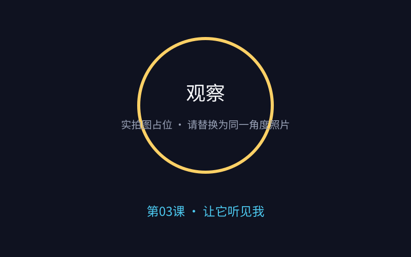

# 知识卡 · 唤醒词（代号贴纸：K06-06）

> 打印建议：A5 横向 / 一页两卡对折；正面给孩子看（大字 + 图），背面给家长看。

## 正面（给孩子看）

### ① 看到什么
有的设备听见“你好小智”才理你，别的话它不动。

### ② 先猜
它怎么知道你在叫它？

- A. 一直听
- B. 听到特定词才醒

### ③ 动手验证（家里就能做，5 分钟）

1. 和家人约定一个暗号
2. 只有说暗号才回应
3. 你看到 说别的话不回应

### ④ 它叫什么

- 外号：暗号
- 正式名：**唤醒词**
- 一句话：像叫小名，只有叫对了才回头

### ⑤ 还在哪见过

- 家里：智能音箱、电视语音
- 外面：电梯语音、车载语音

---

## 背面（给家长看）

| 项 | 内容 |
|---|---|
| 这张卡想让孩子明白 | 知道唤醒词是叫醒设备的暗号 |
| ② 的引导 | 等 10 秒再给线索；答错就说“那我们试试看” |
| ③ 的预期结果 | 暗号外不回应；孩子能复述暗号 |
| 适合档位 | L1 说现象 / L2 换一个变量再试 / L3 讲给家人听 |
| 常见误解 | 以为设备一直在上传；实际唤醒后才对话 |
| 延伸追问 | 1）唤醒词是什么？ 2）为什么要设唤醒词？ 3）没唤醒会录音吗？ |
| 线索记录 | 日期 __ ／ 现象 __ ／ 结论 __ |

> 集卡规则：本卡盖 1 枚章；同一主题集满 3 张发称号「暗号员」。
