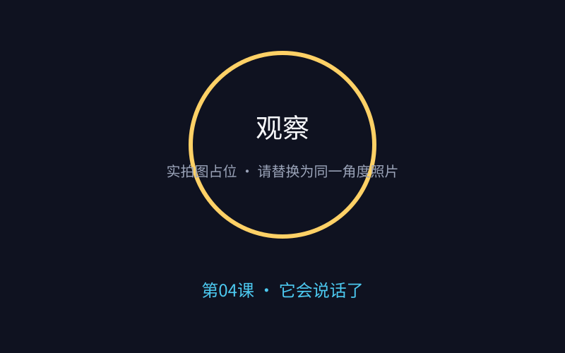

# 知识卡 · 语音识别（代号贴纸：K06-07）

> 打印建议：A5 横向 / 一页两卡对折；正面给孩子看（大字 + 图），背面给家长看。

## 正面（给孩子看）

### ① 看到什么
你说 Hello，屏幕上出现了 Hello 这几个字母。

### ② 先猜
谁把声音变成字？

- A. 喇叭
- B. ASR

### ③ 动手验证（家里就能做，5 分钟）

1. 用手机语音输入说一句话
2. 看它变成文字
3. 你看到 说的和写的不完全一样

### ④ 它叫什么

- 外号：听写员
- 正式名：**语音识别（ASR）**
- 一句话：像听写老师，把听到的写成字

### ⑤ 还在哪见过

- 家里：手机语音输入、导航
- 外面：会议字幕、客服机器人

---

## 背面（给家长看）

| 项 | 内容 |
|---|---|
| 这张卡想让孩子明白 | 知道 ASR 把语音转成文字 |
| ② 的引导 | 等 10 秒再给线索；答错就说“那我们试试看” |
| ③ 的预期结果 | 语音输入出现文字；说快了会错 |
| 适合档位 | L1 说现象 / L2 换一个变量再试 / L3 讲给家人听 |
| 常见误解 | 以为 ASR 懂意思；实际只转文字 |
| 延伸追问 | 1）ASR 是什么？ 2）它会把话听错吗？ 3）吵的时候为什么更差？ |
| 线索记录 | 日期 __ ／ 现象 __ ／ 结论 __ |

> 集卡规则：本卡盖 1 枚章；同一主题集满 3 张发称号「听写员」。
