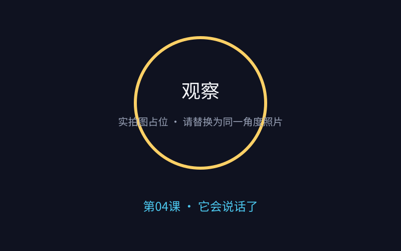

# 知识卡 · 大模型（代号贴纸：K06-08）

> 打印建议：A5 横向 / 一页两卡对折；正面给孩子看（大字 + 图），背面给家长看。

## 正面（给孩子看）

### ① 看到什么
它回答你的话，不是提前录好的。

### ② 先猜
答案是谁想的？

- A. 屏幕
- B. 大模型

### ③ 动手验证（家里就能做，5 分钟）

1. 问家人一个没准备的问题
2. 看对方怎么组织回答
3. 你看到 回答是现场想出来的

### ④ 它叫什么

- 外号：大脑
- 正式名：**大语言模型（LLM）**
- 一句话：像读过很多书的同学，现场组织答案

### ⑤ 还在哪见过

- 家里：手机助手、翻译软件
- 外面：客服、写作工具

---

## 背面（给家长看）

| 项 | 内容 |
|---|---|
| 这张卡想让孩子明白 | 知道大模型根据上下文生成回答 |
| ② 的引导 | 等 10 秒再给线索；答错就说“那我们试试看” |
| ③ 的预期结果 | 回答不是固定的；同问题两次可能不同 |
| 适合档位 | L1 说现象 / L2 换一个变量再试 / L3 讲给家人听 |
| 常见误解 | 以为它每次查同一份答案；实际是生成 |
| 延伸追问 | 1）大模型在哪？ 2）它为什么会答错？ 3）断网它还能想吗？ |
| 线索记录 | 日期 __ ／ 现象 __ ／ 结论 __ |

> 集卡规则：本卡盖 1 枚章；同一主题集满 3 张发称号「思考员」。
