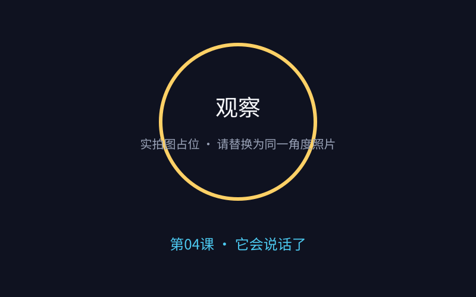

# 知识卡 · 语音合成（代号贴纸：K06-09）

> 打印建议：A5 横向 / 一页两卡对折；正面给孩子看（大字 + 图），背面给家长看。

## 正面（给孩子看）

### ① 看到什么
文字变成声音，从喇叭里出来。

### ② 先猜
谁把字变成声音？

- A. TTS
- B. 麦克风

### ③ 动手验证（家里就能做，5 分钟）

1. 用手机朗读功能读一段字
2. 换一个音色
3. 你看到 同一段字声音不同

### ④ 它叫什么

- 外号：播音员
- 正式名：**语音合成（TTS）**
- 一句话：像播音员，把稿子念出来

### ⑤ 还在哪见过

- 家里：手机朗读、故事机
- 外面：报站、导航播报

---

## 背面（给家长看）

| 项 | 内容 |
|---|---|
| 这张卡想让孩子明白 | 知道 TTS 把文字转成语音 |
| ② 的引导 | 等 10 秒再给线索；答错就说“那我们试试看” |
| ③ 的预期结果 | 能切换音色；语速可调 |
| 适合档位 | L1 说现象 / L2 换一个变量再试 / L3 讲给家人听 |
| 常见误解 | 以为 TTS 是录音；实际是现场合成 |
| 延伸追问 | 1）TTS 是什么？ 2）为什么有的声音像真人？ 3）语速能调吗？ |
| 线索记录 | 日期 __ ／ 现象 __ ／ 结论 __ |

> 集卡规则：本卡盖 1 枚章；同一主题集满 3 张发称号「播音员」。
