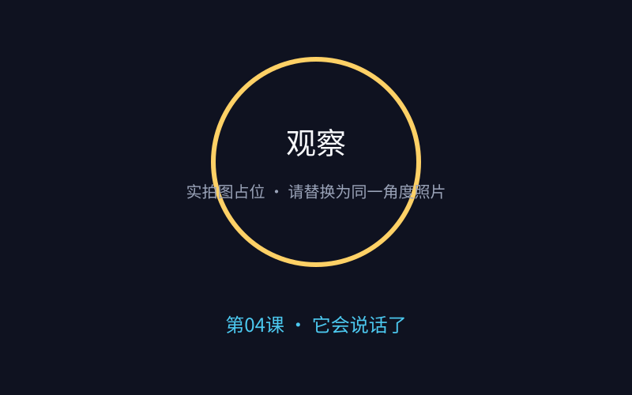

# 知识卡 · 延迟（代号贴纸：K06-10）

> 打印建议：A5 横向 / 一页两卡对折；正面给孩子看（大字 + 图），背面给家长看。

## 正面（给孩子看）

### ① 看到什么
说完话，要等一会儿它才出声。

### ② 先猜
等待时间花在哪？

- A. 只有喇叭
- B. 听、想、说三处

### ③ 动手验证（家里就能做，5 分钟）

1. 和家人玩传话
2. 每人重复一句
3. 你看到 人越多越慢

### ④ 它叫什么

- 外号：排队时间
- 正式名：**延迟**
- 一句话：像排队点餐，前面人越多等越久

### ⑤ 还在哪见过

- 家里：手机加载、视频缓冲
- 外面：点餐排队、快递

---

## 背面（给家长看）

| 项 | 内容 |
|---|---|
| 这张卡想让孩子明白 | 知道延迟来自多段处理 |
| ② 的引导 | 等 10 秒再给线索；答错就说“那我们试试看” |
| ③ 的预期结果 | 能说出“听、想、说”三段 |
| 适合档位 | L1 说现象 / L2 换一个变量再试 / L3 讲给家人听 |
| 常见误解 | 以为慢就是设备坏；实际是网络/模型/音频排队 |
| 延伸追问 | 1）延迟是什么？ 2）哪一段最慢？ 3）怎么变快？ |
| 线索记录 | 日期 __ ／ 现象 __ ／ 结论 __ |

> 集卡规则：本卡盖 1 枚章；同一主题集满 3 张发称号「计时员」。
