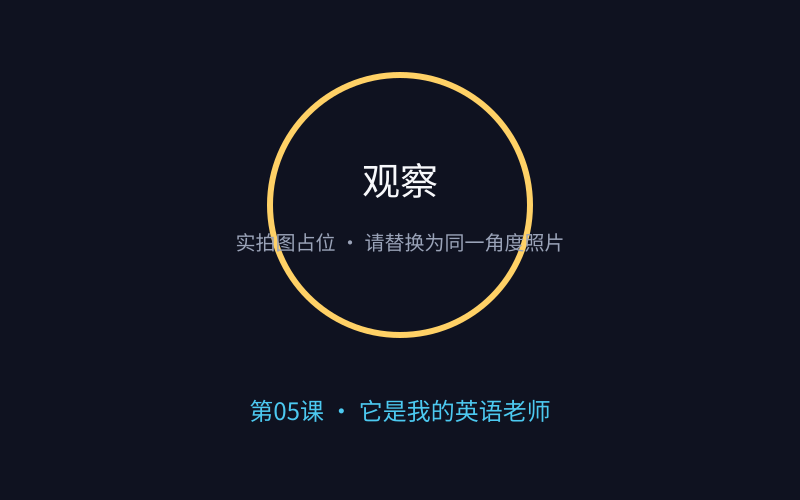

# 知识卡 · 提示词（代号贴纸：K06-11）

> 打印建议：A5 横向 / 一页两卡对折；正面给孩子看（大字 + 图），背面给家长看。

## 正面（给孩子看）

### ① 看到什么
同一台设备，换一段“规则”，说话风格就变了。

### ② 先猜
规则写在哪？

- A. 屏幕
- B. Prompt

### ③ 动手验证（家里就能做，5 分钟）

1. 给家人写 3 条游戏规则
2. 按规则玩一次
3. 你看到 规则变了，玩法就变

### ④ 它叫什么

- 外号：规则卡
- 正式名：**提示词（Prompt）**
- 一句话：像给演员的剧本，写什么就演什么

### ⑤ 还在哪见过

- 家里：说明书、游戏规则
- 外面：比赛规则、交通标志

---

## 背面（给家长看）

| 项 | 内容 |
|---|---|
| 这张卡想让孩子明白 | 知道 Prompt 是给大模型的规则 |
| ② 的引导 | 等 10 秒再给线索；答错就说“那我们试试看” |
| ③ 的预期结果 | 能说出“改规则→改行为” |
| 适合档位 | L1 说现象 / L2 换一个变量再试 / L3 讲给家人听 |
| 常见误解 | 以为 Prompt 是代码；实际是自然语言规则 |
| 延伸追问 | 1）Prompt 是什么？ 2）改一条会怎样？ 3）写越长越好吗？ |
| 线索记录 | 日期 __ ／ 现象 __ ／ 结论 __ |

> 集卡规则：本卡盖 1 枚章；同一主题集满 3 张发称号「规则员」。
