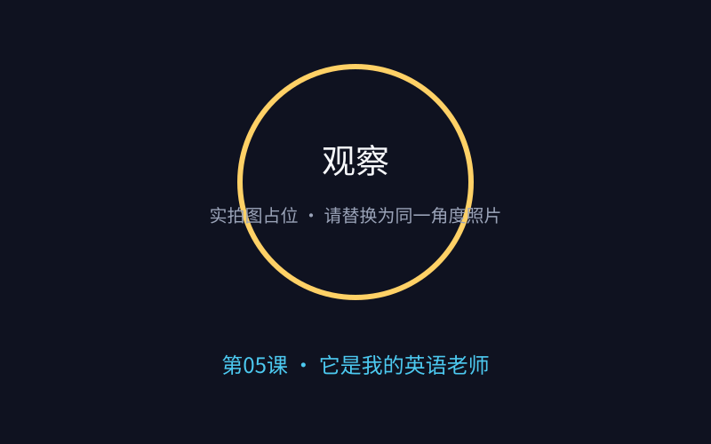

# 知识卡 · 记忆（代号贴纸：K06-12）

> 打印建议：A5 横向 / 一页两卡对折；正面给孩子看（大字 + 图），背面给家长看。

## 正面（给孩子看）

### ① 看到什么
它记得你昨天学过的单词。

### ② 先猜
它把记忆放在哪？

- A. 屏幕里
- B. 记忆模块/本子

### ③ 动手验证（家里就能做，5 分钟）

1. 让家人记 3 个词
2. 10 分钟后再问
3. 你看到 记住或忘掉

### ④ 它叫什么

- 外号：小本子
- 正式名：**记忆（Memory）**
- 一句话：像随身小本子，记下重点，不记全部

### ⑤ 还在哪见过

- 家里：备忘录、错题本
- 外面：病历本、快递单

---

## 背面（给家长看）

| 项 | 内容 |
|---|---|
| 这张卡想让孩子明白 | 知道记忆是选择性保存 |
| ② 的引导 | 等 10 秒再给线索；答错就说“那我们试试看” |
| ③ 的预期结果 | 能说清“记什么、不记什么” |
| 适合档位 | L1 说现象 / L2 换一个变量再试 / L3 讲给家人听 |
| 常见误解 | 以为它记得所有对话；实际只存允许记的 |
| 延伸追问 | 1）记忆存在哪？ 2）会记声音吗？ 3）怎么删掉？ |
| 线索记录 | 日期 __ ／ 现象 __ ／ 结论 __ |

> 集卡规则：本卡盖 1 枚章；同一主题集满 3 张发称号「记录员」。
