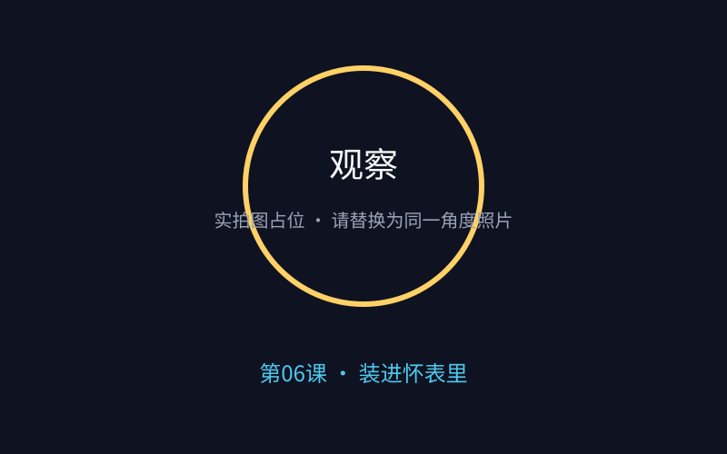

# 知识卡 · Wi-Fi 与天线（代号贴纸：K06-13）

> 打印建议：A5 横向 / 一页两卡对折；正面给孩子看（大字 + 图），背面给家长看。

## 正面（给孩子看）

### ① 看到什么
装进壳里后，离路由器远一点就卡了。

### ② 先猜
信号怕什么？

- A. 塑料
- B. 金属和电池

### ③ 动手验证（家里就能做，5 分钟）

1. 把手机放进铁盒
2. 看 Wi-Fi 格数
3. 你看到 信号变弱

### ④ 它叫什么

- 外号：隐形线
- 正式名：**Wi-Fi 天线**
- 一句话：像看不见的绳子，被金属挡住就变弱

### ⑤ 还在哪见过

- 家里：路由器、手机
- 外面：商场 Wi-Fi、地铁

---

## 背面（给家长看）

| 项 | 内容 |
|---|---|
| 这张卡想让孩子明白 | 知道天线附近不能放金属/电池 |
| ② 的引导 | 等 10 秒再给线索；答错就说“那我们试试看” |
| ③ 的预期结果 | 铁盒里信号变弱；取出恢复 |
| 适合档位 | L1 说现象 / L2 换一个变量再试 / L3 讲给家人听 |
| 常见误解 | 以为壳越厚越好；实际会挡信号 |
| 延伸追问 | 1）天线在哪？ 2）为什么装壳后变差？ 3）怎么留窗？ |
| 线索记录 | 日期 __ ／ 现象 __ ／ 结论 __ |

> 集卡规则：本卡盖 1 枚章；同一主题集满 3 张发称号「信号员」。
