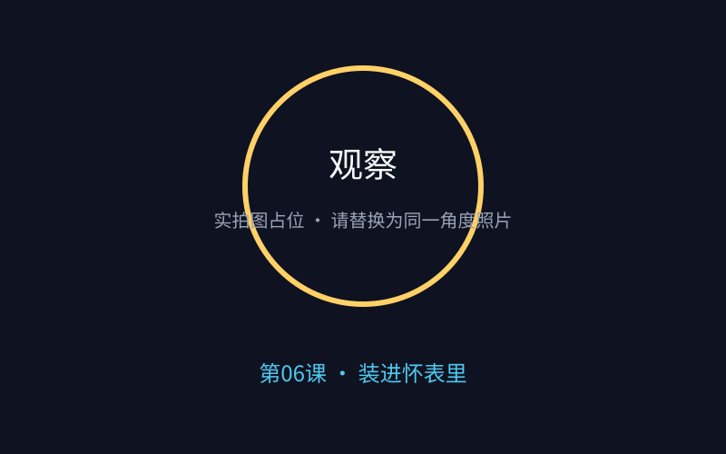

# 知识卡 · 充电保护（代号贴纸：K06-14）

> 打印建议：A5 横向 / 一页两卡对折；正面给孩子看（大字 + 图），背面给家长看。

## 正面（给孩子看）

### ① 看到什么
电池快没电时，设备会提醒你充电。

### ② 先猜
充电时谁在保护电池？

- A. 屏幕
- B. 保护板/电源管理

### ③ 动手验证（家里就能做，5 分钟）

1. 看充电宝/电池上的小标签
2. 找到“保护板”
3. 你看到 一块小电路板

### ④ 它叫什么

- 外号：安全阀
- 正式名：**保护板**
- 一句话：像水龙头的限压阀，压力太大就关

### ⑤ 还在哪见过

- 家里：充电宝、手机电池
- 外面：电动车电池、充电桩

---

## 背面（给家长看）

| 项 | 内容 |
|---|---|
| 这张卡想让孩子明白 | 知道过充/过放会伤电池 |
| ② 的引导 | 等 10 秒再给线索；答错就说“那我们试试看” |
| ③ 的预期结果 | 能找到保护板；找不到就看电池上的小片 |
| 适合档位 | L1 说现象 / L2 换一个变量再试 / L3 讲给家人听 |
| 常见误解 | 以为电池越大越安全；实际要看保护板和质量 |
| 延伸追问 | 1）保护板干什么？ 2）为什么不能用快充头？ 3）鼓包怎么办？ |
| 线索记录 | 日期 __ ／ 现象 __ ／ 结论 __ |

> 集卡规则：本卡盖 1 枚章；同一主题集满 3 张发称号「安全员」。
