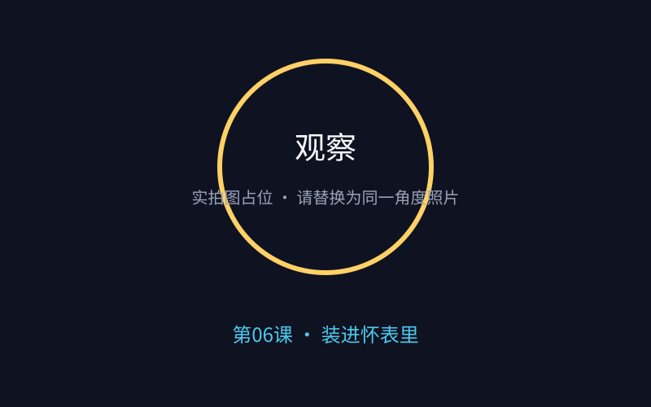

# 知识卡 · 续航（代号贴纸：K06-15）

> 打印建议：A5 横向 / 一页两卡对折；正面给孩子看（大字 + 图），背面给家长看。

## 正面（给孩子看）

### ① 看到什么
有的怀表能用半天，有的只能用一小时。

### ② 先猜
什么最耗电？

- A. 息屏
- B. 屏幕+Wi-Fi+喇叭

### ③ 动手验证（家里就能做，5 分钟）

1. 手机开飞行模式 1 小时
2. 再开 Wi-Fi 看视频 1 小时
3. 你看到 耗电不同

### ④ 它叫什么

- 外号：耐力
- 正式名：**续航**
- 一句话：像跑步，说话比走路更费力气

### ⑤ 还在哪见过

- 家里：手机、手表、玩具
- 外面：电动车、无人机

---

## 背面（给家长看）

| 项 | 内容 |
|---|---|
| 这张卡想让孩子明白 | 知道屏幕/网络/声音都耗电 |
| ② 的引导 | 等 10 秒再给线索；答错就说“那我们试试看” |
| ③ 的预期结果 | 能说出“少亮屏、少说话更省电” |
| 适合档位 | L1 说现象 / L2 换一个变量再试 / L3 讲给家人听 |
| 常见误解 | 以为电池大就一定用得久；实际看功耗 |
| 延伸追问 | 1）续航是什么？ 2）什么最耗电？ 3）怎么让它更久？ |
| 线索记录 | 日期 __ ／ 现象 __ ／ 结论 __ |

> 集卡规则：本卡盖 1 枚章；同一主题集满 3 张发称号「耐力员」。
