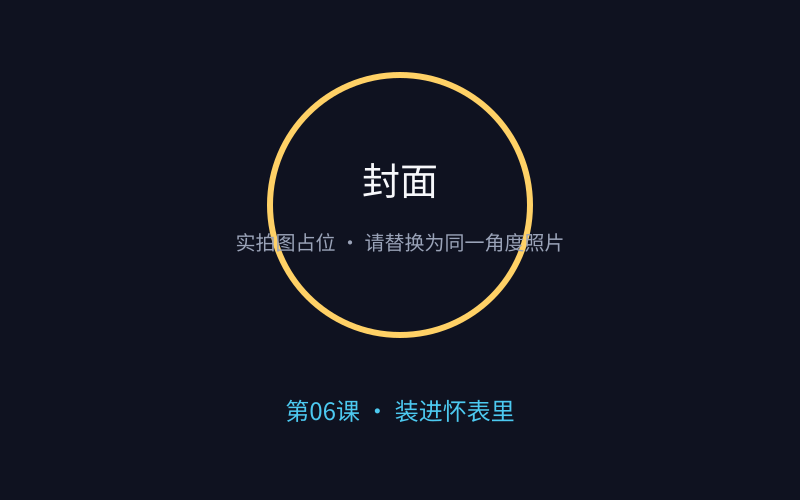
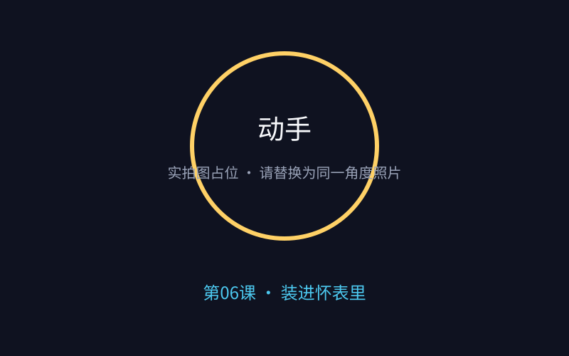

# 英语宠物怀表 · 第 6 课
<!-- layout: title -->

今天把它戴起来
<!-- notes: 开场 30 秒，只说目标：装壳并做 3 分钟展示。 -->

---
<!-- layout: image -->
## 先看零件

<!-- notes: 让孩子点件数；缺件先不装，记录在清单上。 -->

---
<!-- layout: big -->
## 猜一猜
先装什么？
<!-- notes: 让孩子先猜；顺序是先断电、再固定板子/电池、最后合壳。 -->

---
## 动手：三步
1. 断电
2. 固定板子/电池
3. 合壳

<!-- notes: 装壳由家长主导；孩子递件、对件号，不碰电池插头。 -->

---
<!-- layout: big -->
## 通关条件
合壳后还能对话
<!-- notes: 让孩子自己试：屏幕、触摸、麦克风、喇叭、Wi-Fi 全正常。 -->

---
<!-- layout: image -->
## 观察：整机

<!-- notes: 记录 30 分钟对话后的电量与温度；不发烫才算过。 -->

---
<!-- layout: two-col -->
### 我们发现的
- 合壳后能对话
- 天线要留空
### 记下的线索
- 续航 __ 分钟
<!-- notes: 收尾 3 问：最满意哪里 / 哪里最难 / 还想改什么。 -->

---
<!-- layout: big -->
## 小心
电池不压不折
<!-- notes: 家长复述：电池不压、不折、不贴高温；鼓包立即停用。 -->

---
<!-- layout: title -->
# 恭喜过关
你现在是「怀表工程师」了
<!-- notes: 盖章、发称号；按 04-验收与展示.md 做 3 分钟展示。 -->
