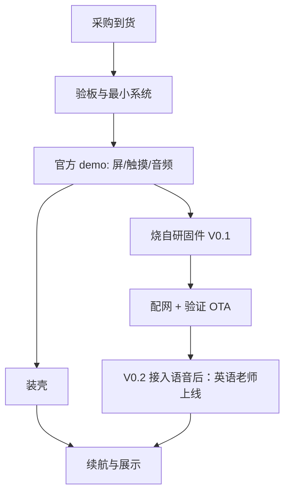

# 六维拆解总表（英语宠物怀表）

| 字段 | 值 |
|---|---|
| 适用版本 | 方案 v1.0 |
| 最后更新 | 2026-11-13 |
| 前置条件 | 读完 `00-总纲与路线图.md` |

## 1. 六维总表

| 维度 | 是什么 / 包含什么 | 买什么（MVP 部分） | 谁做 | 门槛（最难三步） | 降级路径（可外包/买成品） | 实现路径（买成品/代做/自制 + 参数） | 卡点 |
|---|---|---|---|---|---|---|---|
| ① 硬件电子 | ESP32-S3 开发板、AMOLED 触摸屏、ES8311/ES7210 音频、双麦、AXP2101 电源、LiPo 电池、喇叭 | Waveshare ESP32-S3-Touch-AMOLED-1.75 + 8Ω 2W 喇叭 + 1500mAh 带保护板电池 | 家长 L2 / 孩子 L1 | 认版本（1.75 vs 1.75C）、电池极性、喇叭接口 | 买成品开发板 + 带插头喇叭；不焊接 | 开发板整板购买；电池 MX1.25 成品；喇叭插板载座；不画 PCB | 电池反接、喇叭无声、装壳挡天线 |
| ② 结构外壳 | 怀表前后壳、屏幕压圈、喇叭腔、麦克风孔、天线窗、挂绳孔 | PETG 打印件或先用纸板/现成盒 | 家长 L2 / 孩子 L1 | 屏幕开孔公差、壳厚、天线净空 | 淘宝代打 / 打印店；先用纸板 1:1 模型 | PETG、0.2mm 层高、壁厚 1.6–2mm、填充 20–40%；公差 ±0.2mm；天线区开非金属窗 | 壳装不进、合壳后 Wi-Fi 变差、喇叭回灌 |
| ③ 固件 | ESP-IDF 6.0.1+、自研固件（V0.1 Wi-Fi+OTA；V0.2 音频/WS）、板级引脚参考、LVGL 表盘、配网 | 无（开源） | 家长 L2 / 孩子 L1 | 装 ESP-IDF、填 Wi-Fi/OTA 地址、串口驱动 | 先用 V0.1 跑通联网与 OTA；语音后续加 | 源码编译：`idf.py set-target esp32s3` → menuconfig → build → flash | 串口识别不到、1.75/1.75C 引脚错、OTA 地址/固件命名错 |
| ④ 上位机/服务端 | xiaozhi-esp32-server、ASR/LLM/TTS 供应商、英语老师 Prompt、家长配置 | 一台常开的电脑/NAS + 云服务账号 | 家长 L2 / 孩子 L1 | Docker 部署、供应商密钥、设备与电脑同网段 | 用服务商托管版；或先只在一台电脑上本地跑 | Docker Compose；8000 WebSocket / 8003 OTA；`.config.yaml` 配 Prompt | 端口/防火墙、模型文件缺失、欠费 |
| ⑤ 算法代码 | 本地唤醒/触摸、VAD、AEC、Opus、流式 ASR、LLM、TTS、发音评测、单词本 | 无（服务端配置） | 家长 L2 / 孩子 L1–L3 | 首响延迟、AEC 回灌、英语口音识别 | 先不做唤醒词（触摸说话）；发音评测放 V2 | 流式管线；Prompt 约束短句；每 3 轮复习；单词本用服务端存储 | 抢话、识别错、TTS 断流、模型跑题 |
| ⑥ 资料与生态 | xiaozhi 固件/服务端、Waveshare Wiki、云厂商文档、许可边界 | 无 | 家长 L1 / 孩子 L1 | 找到板级配置与服务端配置入口 | 只读官方 Wiki/README，不自行改板 | 所有链接登记在 `docs/99-参考资源.md`，标访问日期 | 链接失效、供应商接口变更 |

> 采购明细与参考价见 `05-安全与工具采购清单.md`；工程参数以 `projects/english-pet-watch/docs/` 为准。

## 2. 依赖关系

关键路径：**服务端与网络**。屏幕和音频是硬件活，照 demo 做就行；真正容易卡的是「设备连不上电脑」「云端欠费/密钥错」「ASR 识别不准」。所以 M2 先把服务端跑通，再装壳。

## 3. 家长技能矩阵（本项目实际需要）

| 技能 | 本项目是否需要 | 用在哪一步 | 零基础替代方案 |
|---|---|---|---|
| 焊接 | **不需要** | 喇叭买带插头的；电池买成品 | 买 MX1.25 成品线束 |
| 烧录固件 | 需要 | M2 烧自研 V0.1 | 请创客空间/卖家代烧；或先用上游预编译固件做对照 |
| 命令行 | 需要（复制粘贴） | 装 ESP-IDF、Docker | 照文档逐行复制；只改 IP |
| 3D 打印 | 可选 | M4 装壳 | 纸板壳/现成盒；淘宝代打 |
| 金属加工 | 不需要 | — | — |
| 调试排错 | **必须**（无法外包） | 全程 | 按 `04-验收与展示.md` 的排查顺序做 |

## 4. Top 卡点清单（提前预防）

| # | 卡点 | 现象 | 预防手段 | 出现后先查什么 |
|---|---|---|---|---|
| 1 | 串口识别不到 | `idf.py flash` 找不到口 | 用能传数据的线；先跑官方 demo | 换线 → 装 CP210x/CH34x 驱动 → 关占用程序 |
| 2 | 设备连不上服务端 | 一直配网/重连 | 设备与电脑同 2.4GHz Wi-Fi；先 `ping` | IP/端口 → 防火墙 → OTA 地址 |
| 3 | 说话没反应 | ASR 无文本 | 麦克风孔没堵；靠近说话；先用日志看 | 音频 demo → 麦克风增益 → ASR 语言 |
| 4 | 喇叭无声/破音 | 有日志但没声 | 先跑 `06_I2SCodec`；音量 ≤70% | PA 使能 GPIO46 → 喇叭阻抗/插头 |
| 5 | 装壳后 Wi-Fi 差 | 合壳就断连 | 天线区不贴电池、不用金属壳 | 天线窗 → 电池位置 → 换 2.4G 信道 |
| 6 | 聊两分钟就断 | TTS 超时/欠费/网络 | 先设时长与预算上限 | 服务端日志 → 供应商余额 → 缩短回复 |

## 5. 与工程文档的对应关系

| 本手册章节 | 对应工程文档 |
|---|---|
| ① 硬件电子 | `projects/english-pet-watch/hardware/` |
| ② 结构外壳 | `projects/english-pet-watch/enclosure/` |
| ③ 固件 | `projects/english-pet-watch/firmware/` |
| ④ 上位机/服务端 | `projects/english-pet-watch/software/` |
| ⑤ 算法代码 | `projects/english-pet-watch/code/` |
| ⑥ 资料与生态 | `projects/english-pet-watch/docs/99-参考资源.md` |
