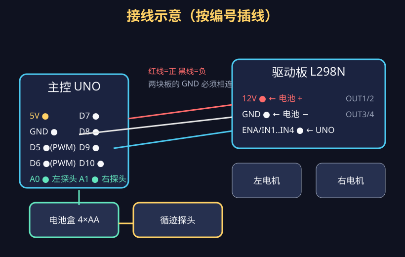

<!--
知识卡 K02-01 · 电池与电源
写法与语言规则见 skill references/儿童友好设计.md 第六节；可打印，一页一张。
-->

# 知识卡 · 电池和电（代号贴纸：K02-01）

> 打印建议：A5 横向 / 一页两卡对折；正面给孩子看（大字 + 图），背面给家长看（怎么问、线索记录）。

## 正面（给孩子看）

### ① 看到什么
小车不装电池，怎么按都不动；装上电池，灯就亮了。

### ② 先猜
电池里的"电"，是像水一样流出来吗？

- A. 像水流到各个零件
- B. 像光一样照过去

### ③ 动手验证（家里就能做，5 分钟）

1. 找一把小手电，装上电池 → 亮
2. 把电池**反着装**（正负极调个头）→ 大多不亮
3. 你看到：装对了才亮，装反了不亮

### ④ 它叫什么

- 外号：小水库
- 正式名：**电压 / 电流**
- 一句话：电压像水压，电流像水流（小水库往管子里推水）

### ⑤ 还在哪见过

- 家里：遥控器、手电、闹钟里的电池
- 外面：电动车的电池组、手机里的锂电池

---

## 背面（给家长看）

| 项 | 内容 |
|---|---|
| 这张卡想让孩子明白 | 电要"接对方向"才能用，正负不能反 |
| ② 的引导 | 等 10 秒再给线索；答错就说"那我们试试看" |
| ③ 的预期结果 | 正装亮、反装不亮；看不到时先查电池是否有电、是否装到底 |
| 适合档位 | L1 说现象 / L2 换一节电池再试 / L3 讲给家人听 |
| 常见误解 | 以为"有电池就一定亮"，实际还要方向对、接触好 |
| 延伸追问 | 1）为什么电池有大有小？ 2）为什么小车要用 4 节？ 3）没电了灯会怎样？ |
| 线索记录 | 日期 __ ／ 现象 __ ／ 结论 __ |

> 集卡规则：本卡盖 1 枚章；"电"主题集满 3 张发称号「小电工」，贴纸贴在卡片右上角代号处。
