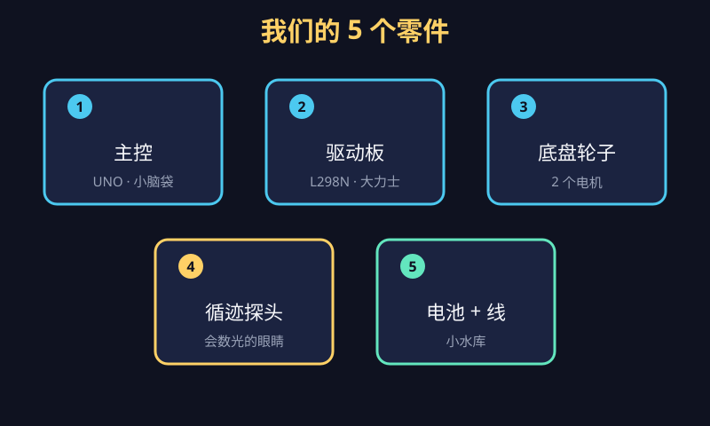

<!--
知识卡 K02-02 · 主控与固件
-->

# 知识卡 · 小车的大脑（代号贴纸：K02-02）

> 打印建议：A5 横向 / 一页两卡对折；正面给孩子看，背面给家长看。

## 正面（给孩子看）

### ① 看到什么
同一块板子，烧进不同程序，小车做的事就不一样。

### ② 先猜
板子自己会做事，还是有人"教"过它？

- A. 天生就会
- B. 要先教它（装程序）

### ③ 动手验证（家里就能做，5 分钟）

1. 找家里的遥控器 / 计算器
2. 想：它为什么知道按这个键做什么？
3. 你看到：它里面也藏着一套"说明书"（程序）

### ④ 它叫什么

- 外号：小脑袋
- 正式名：**主控（单片机）/ 固件**
- 一句话：主控是脑袋，固件是脑袋里记住的做法

### ⑤ 还在哪见过

- 家里：洗衣机、遥控器、电子秤
- 外面：红绿灯、电梯、自动门

---

## 背面（给家长看）

| 项 | 内容 |
|---|---|
| 这张卡想让孩子明白 | 机器不会"天生就懂"，是被人装了程序 |
| ② 的引导 | 等 10 秒再给线索；答错就说"那我们试试看" |
| ③ 的预期结果 | 孩子能说出"它里面有人写好的做法" |
| 适合档位 | L1 说现象 / L2 找家里 3 个"有小脑袋"的东西 / L3 讲给家人听 |
| 常见误解 | 以为主控"自己会思考"；实际只是照着程序一步步做 |
| 延伸追问 | 1）程序是谁写的？ 2）程序写错了会怎样？ 3）能改吗？ |
| 线索记录 | 日期 __ ／ 现象 __ ／ 结论 __ |

> 集卡规则：本卡盖 1 枚章；"大脑"主题集满 3 张发称号「小程序员」。
