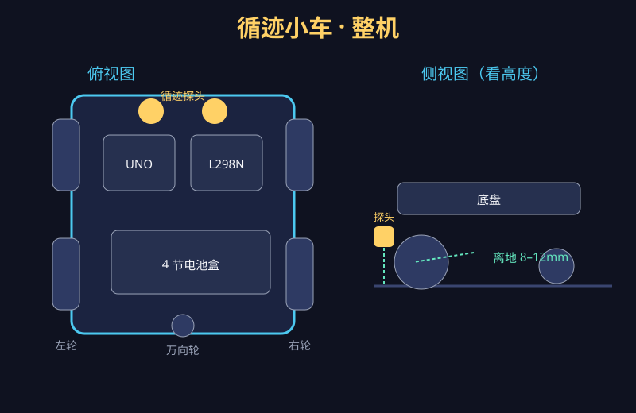
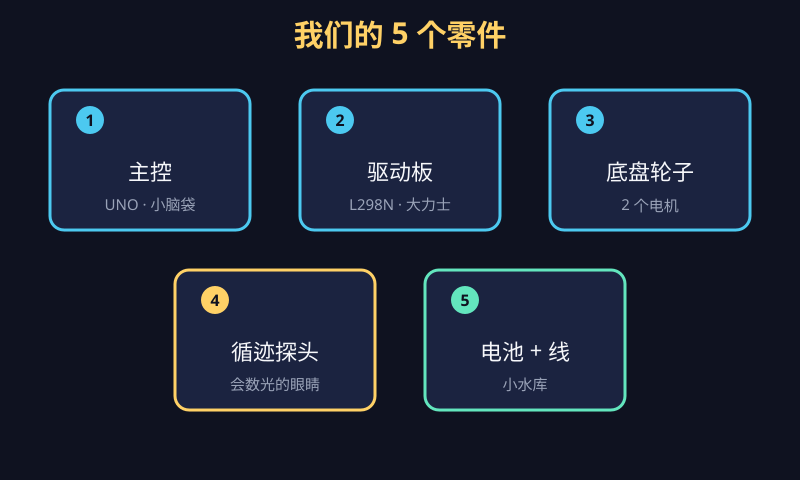

<!--
课件 · 第 1 课：认识我们的零件
构建：python3 .trae/skills/stem-project-onboarding/scripts/build_slides.py projects/line-follower-car/docs/儿童课程/第01课-认识我们的零件/课件.md
放映：浏览器打开生成的 01-认识我们的零件.html，← → 翻页，F 全屏，N 备注，Ctrl+P 导 PDF
-->

<!-- layout: title -->
# 循迹小车 · 第 1 课

今天只做一件事：认识 5 个零件
<!-- notes: 开场 30 秒。只说今天要做什么，不讲原理，不预告难点。 -->

---
<!-- layout: image -->
## 先看，不许说话

<!-- notes: 给孩子看 10 秒，然后问"你看到了什么"。孩子说错也不纠正，记在纸上留到最后对照。 -->

---
<!-- layout: big -->
## 猜一猜
它靠什么认识黑线？
<!-- notes: 让孩子先猜再动手。答案不写在页面上；答错就说"那我们试试看"。 -->

---
## 认识 5 个零件
1 主控 2 驱动板 3 底盘轮子
4 循迹探头 5 电池和线

<!-- notes: 一次只介绍一个零件。让孩子摸一摸，说出它像家里的什么东西。 -->

---
## 动手（3 步）
1 把零件按 1–5 摆开
2 每个零件说出名字
3 数一数，一共几个

<!-- notes: 一次只做这一件事。摆好后拍一张照留档。 -->

---
<!-- layout: big -->
## 通关条件
5 个零件都叫得出名字
<!-- notes: 让孩子自己判断有没有过关。家长不评价快慢。过关就盖章。 -->

---
<!-- layout: two-col -->
### 我们发现的
- 一共 5 样零件
- 探头有两个"眼睛"
### 记下的线索
- 最容易忘的是 __
<!-- notes: 收尾 3 问：今天成功的标志是什么 / 哪里最麻烦 / 下次想改哪里。 -->

---
<!-- layout: title -->
# 恭喜过关
你现在是「材料员」了
<!-- notes: 盖章、发称号，预告下一关：让轮子转起来。留一个钩子再下课。 -->
