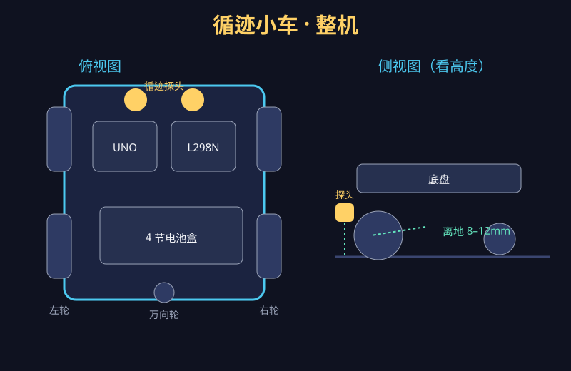

<!--
知识卡 K02-03 · 电机
-->

# 知识卡 · 会转的小马达（代号贴纸：K02-03）

> 打印建议：A5 横向 / 一页两卡对折；正面给孩子看，背面给家长看。

## 正面（给孩子看）

### ① 看到什么
给电机接上电，它就一直转；断电就停。

### ② 先猜
电机转得快，力气就大吗？

- A. 转得快力气也大
- B. 转得慢往往力气更大

### ③ 动手验证（家里就能做，5 分钟）

1. 手捏住小车的一个轮子
2. 请家长通电 1 秒，马上断电
3. 你看到：轮子"顶住"了，还发出嗡嗡声

安全提示：只有家长通电，孩子只观察。

### ④ 它叫什么

- 外号：小马达
- 正式名：**电机（减速电机）**
- 一句话：通电就转；加上减速齿轮，转得慢但更有劲

### ⑤ 还在哪见过

- 家里：电动牙刷、玩具车、风扇
- 外面：扫地机器人、电动卷帘门

---

## 背面（给家长看）

| 项 | 内容 |
|---|---|
| 这张卡想让孩子明白 | 电变成动作；被顶住（堵转）会发烫，要断电 |
| ② 的引导 | 等 10 秒再给线索；答错就说"那我们试试看" |
| ③ 的预期结果 | 轮子顶住、有嗡嗡声，且家长立即断电 |
| 适合档位 | L1 说现象 / L2 换一个速度再试 / L3 讲"为什么堵转会烫" |
| 常见误解 | 以为"转得越快越好"；实际带负载时要慢而有力 |
| 延伸追问 | 1）为什么有两个电机？ 2）为什么要有万向轮？ 3）电机为什么会响？ |
| 线索记录 | 日期 __ ／ 现象 __ ／ 结论 __ |

> 集卡规则：本卡盖 1 枚章；"电机"主题集满 3 张发称号「小机械师」。
