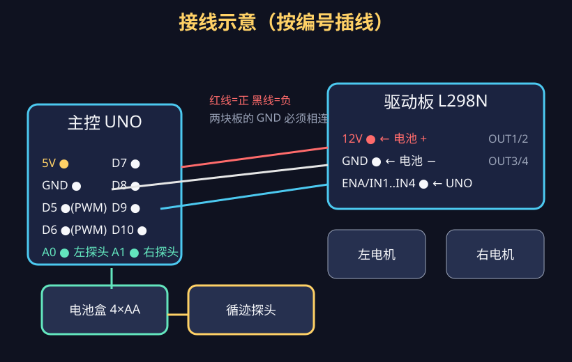

<!--
知识卡 K02-04 · 驱动板与 PWM 调速
-->

# 知识卡 · 电机的"大力士"（代号贴纸：K02-04）

> 打印建议：A5 横向 / 一页两卡对折；正面给孩子看，背面给家长看。

## 正面（给孩子看）

### ① 看到什么
主控自己的电很"小"，带不动电机；中间多了一块板，电机就有劲了。

### ② 先猜
想让它慢一点，是给它更少的电吗？

- A. 直接少给一点电
- B. 快速地开一下、关一下

### ③ 动手验证（家里就能做，5 分钟）

1. 开一下、关一下水龙头，越开关得快
2. 看看接水的杯子，水多不多
3. 你看到：开关得越快，水就越多

### ④ 它叫什么

- 外号：大力士翻译
- 正式名：**驱动板（L298N）+ PWM 调速**
- 一句话：小信号指挥大电流；用"快速开关"来调快慢

### ⑤ 还在哪见过

- 家里：风扇的风速档、调光灯
- 外面：电动车的调速油门、地铁的加速度

---

## 背面（给家长看）

| 项 | 内容 |
|---|---|
| 这张卡想让孩子明白 | 弱信号不能直驱大电流，需要驱动板；快慢用 PWM 开关比例调 |
| ② 的引导 | 等 10 秒再给线索；答错就说"那我们试试看" |
| ③ 的预期结果 | 开关越快水流越多；对应 PWM 占空比越大转速越快 |
| 适合档位 | L1 说现象 / L2 改 `SPEED_NORMAL` 看快慢 / L3 讲清"占空比" |
| 常见误解 | 以为"少给电能变慢"；实际是反复通断，平均下来才变慢 |
| 延伸追问 | 1）为什么驱动板会发热？ 2）为什么电机线接反只会反转不会坏？ 3）调速会让它更省电吗？ |
| 线索记录 | 日期 __ ／ 现象 __ ／ 结论 __ |

> 集卡规则：本卡盖 1 枚章；"驱动"主题集满 3 张发称号「小电工」。
