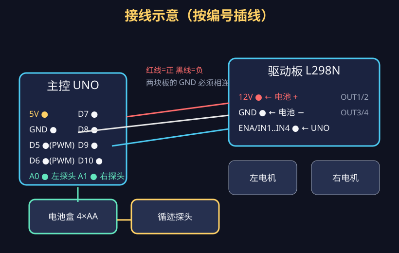

<!--
知识卡 K02-07 · 共地与串口
-->

# 知识卡 · 说同一种语言（代号贴纸：K02-07）

> 打印建议：A5 横向 / 一页两卡对折；正面给孩子看，背面给家长看。

## 正面（给孩子看）

### ① 看到什么
两块板子要有一根黑线连在一起，信号才听得懂；电脑还要一根"对讲线"才知道小车在想什么。

### ② 先猜
两个人打电话，只要话筒够好就行吗？

- A. 还要用同一种语言
- B. 声音大就行

### ③ 动手验证（家里就能做，5 分钟）

1. 和一个家人隔远一点说话
2. 一个说方言、一个说普通话
3. 你看到：声音再大也听不懂——要有"共同的东西"

### ④ 它叫什么

- 外号：说同一种语言
- 正式名：**共地（GND 相连）/ 串口**
- 一句话：两块板子的"负"连一起才好说话；串口是电脑和小车之间的对讲机

### ⑤ 还在哪见过

- 家里：充电线、耳机线（其实里面有好几根线）
- 外面：网线、USB 线、对讲机

---

## 背面（给家长看）

| 项 | 内容 |
|---|---|
| 这张卡想让孩子明白 | 信号要有共同参考点（共地）；电脑靠串口读小车的数据 |
| ② 的引导 | 等 10 秒再给线索；答错就说"那我们试试看" |
| ③ 的预期结果 | 孩子能说出"要有一样的东西才能听懂" |
| 适合档位 | L1 说现象 / L2 找车上的 GND 黑线 / L3 解释为什么拔掉共地线就乱 |
| 常见误解 | 以为"接上电源就够了"；其实不共地时信号会乱跳 |
| 延伸追问 | 1）为什么串口数字一直在刷？ 2）波特率是什么？ 3）为什么拔了 USB 就看不到数字了？ |
| 线索记录 | 日期 __ ／ 现象 __ ／ 结论 __ |

> 集卡规则：本卡盖 1 枚章；"信号"主题集满 3 张发称号「小工程师」。
