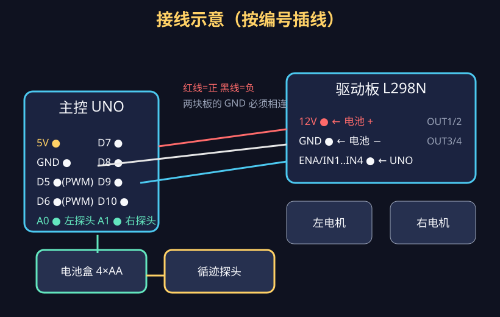

<!--
课件 · 第 2 课：让轮子转起来
构建：python3 .trae/skills/stem-project-onboarding/scripts/build_slides.py projects/line-follower-car/docs/儿童课程/第02课-让轮子转起来/课件.md
-->

<!-- layout: title -->
# 循迹小车 · 第 2 课

今天只做一件事：让轮子听我的话
<!-- notes: 开场 30 秒，只说要做什么。先回看上一课的零件照片。 -->

---
<!-- layout: image -->
## 先看，不许说话

<!-- notes: 给孩子看 10 秒，问"这些线都是从哪到哪"。不提示。 -->

---
<!-- layout: big -->
## 猜一猜
先接红线，还是黑线？
<!-- notes: 等 10 秒再给线索。答案"先负后正"要让孩子自己得出。 -->

---
## 动手（3 步）
1 照编号插好线
2 喊我送电
3 让左轮、右轮各转 2 秒

<!-- notes: 孩子只插线（断电），送电由家长执行，孩子退到一臂之外。 -->

---
<!-- layout: big -->
## 通关条件
左轮右轮都能转
<!-- notes: 让孩子自己判断。过了盖章；没过就一起找第一条线索，不批评。 -->

---
<!-- layout: two-col -->
### 我们发现的
- 电机"嗯嗯"转起来
- 换根线就不转了
### 记下的线索
- 第一次不转，因为 __
<!-- notes: 收尾 3 问。把线索写进线索本，下一课第一件事就查它。 -->

---
<!-- layout: big -->
## 小心
轮子悬空再通电
<!-- notes: 讲安全只说这一句，然后让孩子复述："通电前，轮子要怎样？" -->

---
<!-- layout: title -->
# 恭喜过关
你现在是「接线员」了
<!-- notes: 盖章、发称号，预告下一关：让小车看见黑线。 -->
