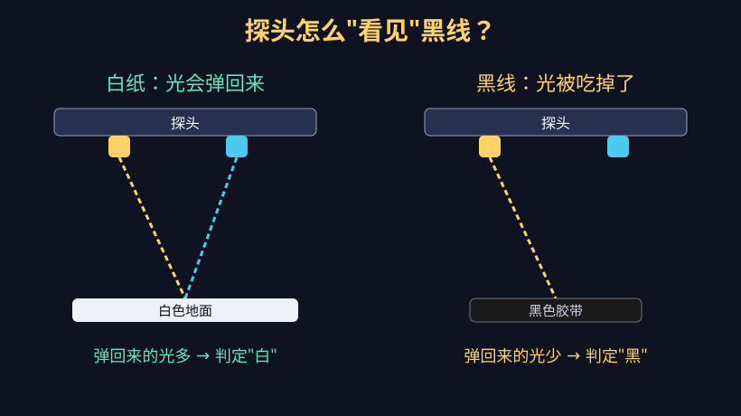

<!--
知识卡 K02-05 · 循迹探头与黑白反射
-->

# 知识卡 · 会数光的眼睛（代号贴纸：K02-05）

> 打印建议：A5 横向 / 一页两卡对折；正面给孩子看，背面给家长看。

## 正面（给孩子看）

### ① 看到什么
探头对着白纸时灯亮，挪到黑线上灯就灭（或反过来）。

### ② 先猜
黑颜色为什么会让探头"看不见"光？

- A. 黑颜色把光吃掉了
- B. 黑颜色把光弹得更远

### ③ 动手验证（家里就能做，5 分钟）

1. 用手机手电筒照一张白纸
2. 再照一件黑衣服
3. 你看到：白纸很亮（光弹回来），黑衣服不亮（光被吃了）

### ④ 它叫什么

- 外号：会数光的眼睛
- 正式名：**红外反射式传感器（循迹探头）**
- 一句话：发一束光出去，数弹回来多少，就知道下面是黑还是白

### ⑤ 还在哪见过

- 家里：自动感应灯、扫地机器人防跌落
- 外面：自动门、感应水龙头、电梯门防夹

---

## 背面（给家长看）

| 项 | 内容 |
|---|---|
| 这张卡想让孩子明白 | 探头靠"反射回来的光"分辨黑白，不是靠"看见颜色" |
| ② 的引导 | 等 10 秒再给线索；答错就说"那我们试试看" |
| ③ 的预期结果 | 白纸亮、黑衣服暗；看不到时先查手电筒与距离 |
| 适合档位 | L1 说现象 / L2 试不同颜色并排序 / L3 讲红外与可见光的区别 |
| 常见误解 | 以为探头"拍照认颜色"；实际只是测反射光强弱 |
| 延伸追问 | 1）为什么探头要离地这么矮？ 2）红色纸和黑纸，哪个更像黑线？ 3）阳光太强时为什么会失灵？ |
| 线索记录 | 日期 __ ／ 现象 __ ／ 结论 __ |

> 集卡规则：本卡盖 1 枚章；"眼睛"主题集满 3 张发称号「观察员」。
