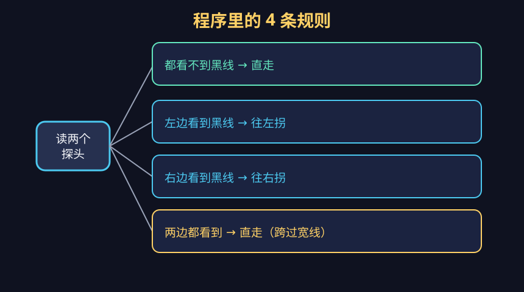

<!--
知识卡 K02-06 · 阈值
-->

# 知识卡 · 及格线（代号贴纸：K02-06）

> 打印建议：A5 横向 / 一页两卡对折；正面给孩子看，背面给家长看。

## 正面（给孩子看）

### ① 看到什么
白纸读出来的数字大，黑线读出来的数字小；中间画一条线，就分开了。

### ② 先猜
这条"及格线"画在哪里最好？

- A. 随便画
- B. 画在两个数字的正中间

### ③ 动手验证（家里就能做，5 分钟）

1. 你的体温大约 36.5℃
2. 高过 37.3℃ 就算发烧
3. 你看到：这条"及格线"就是把两堆数字分开的那条线

### ④ 它叫什么

- 外号：及格线
- 正式名：**阈值**
- 一句话：数字小于它就是"黑"，大于它就是"白"

### ⑤ 还在哪见过

- 家里：体重秤、体温计报警
- 外面：测速拍照、空气质量预警灯

---

## 背面（给家长看）

| 项 | 内容 |
|---|---|
| 这张卡想让孩子明白 | 判断黑白的不是颜色本身，而是"数字 vs 及格线" |
| ② 的引导 | 等 10 秒再给线索；答错就说"那我们试试看" |
| ③ 的预期结果 | 孩子能说出"比及格线大就算发烧"这类类比 |
| 适合档位 | L1 说现象 / L2 改一次阈值看结果 / L3 解释阈值取偏了会发生什么 |
| 常见误解 | 以为阈值是固定值；实际每辆车、每个环境都要重新标 |
| 延伸追问 | 1）两堆数字离得太近怎么办？ 2）换了地方为什么要重调？ 3）这和"及格线"有什么不一样？ |
| 线索记录 | 日期 __ ／ 阈值 __ ／ 结果 __ |

> 集卡规则：本卡盖 1 枚章；"判断"主题集满 3 张发称号「调试员」。
