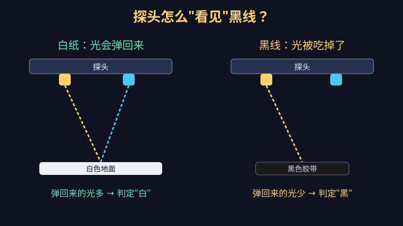
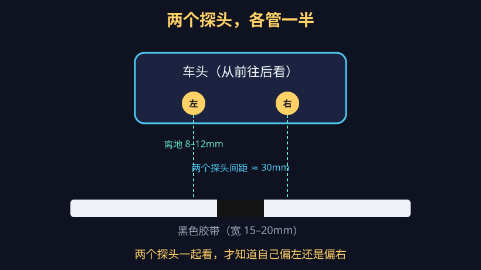
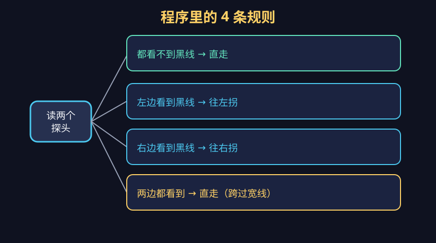

<!--
课件 · 第 3 课：让小车看见黑线
构建：python3 .trae/skills/stem-project-onboarding/scripts/build_slides.py projects/line-follower-car/docs/儿童课程/第03课-让小车看见黑线/课件.md
-->

<!-- layout: title -->
# 循迹小车 · 第 3 课

今天只做一件事：教它看懂黑线
<!-- notes: 开场 30 秒。回看上一课"轮子听我的话"的视频。 -->

---
<!-- layout: image -->
## 先看，不许说话

<!-- notes: 看 10 秒，问"光跑到哪里去了"。不解释，先让孩子猜。 -->

---
<!-- layout: big -->
## 猜一猜
黑线上的数字，大还是小？
<!-- notes: 让孩子先猜。答案不写；动手读一遍就有答案。 -->

---
<!-- layout: image -->
## 探头装在哪

<!-- notes: 重点只有一句：离地 8–12mm、两个一样高。让孩子用手比一比。 -->

---
## 动手（3 步）
1 把探头对黑线，读一次
2 对白底，再读一次
3 算出中间值

<!-- notes: 一次只做一步，把两个数字写在纸上，别急着改程序。 -->

---
## 把数字填进程序
- 填 THRESHOLD
- 不对就改 BLACK_IS_LOW

<!-- notes: 讲清"及格线"这个比喻。改完上传，看串口状态变没变。 -->

---
<!-- layout: big -->
## 通关条件
它自己说出"左拐/右拐"
<!-- notes: 让孩子动手试：左边对黑线应显示"左拐"，右边对黑线显示"右拐"。 -->

---
<!-- layout: two-col -->
### 我们发现的
- 黑线数字小、白底数字大
- 探头顶着白纸最亮
### 记下的线索
- 阈值取 __ 最合适
<!-- notes: 收尾 3 问。线索本记下阈值，下一课直接用它。 -->

---
<!-- layout: title -->
# 恭喜过关
你现在是「调试员」了
<!-- notes: 盖章、发称号，预告 Boss 关：让它自己跑完赛道。 -->
