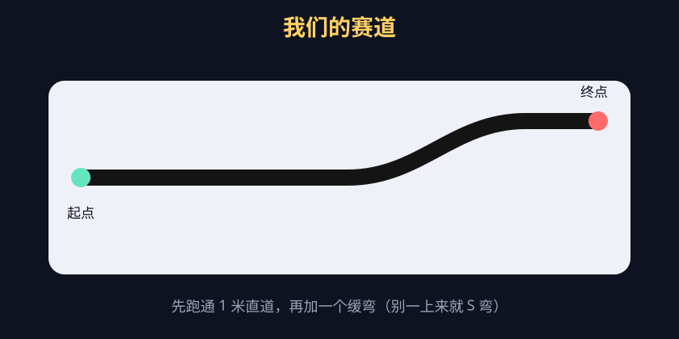
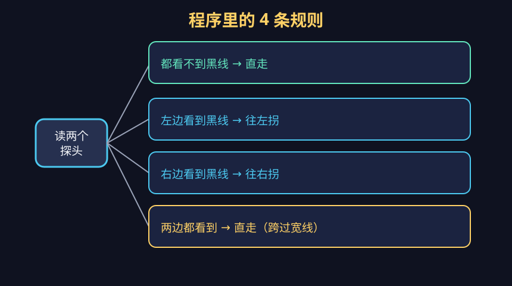
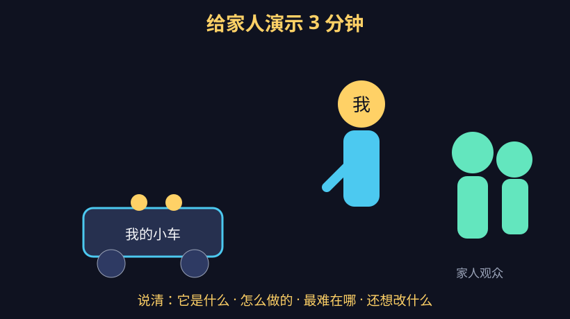

<!--
课件 · 第 4 课：黑线赛跑（Boss 关）
构建：python3 .trae/skills/stem-project-onboarding/scripts/build_slides.py projects/line-follower-car/docs/儿童课程/第04课-黑线赛跑/课件.md
-->

<!-- layout: title -->
# 循迹小车 · 第 4 课

Boss 关：让它自己跑完全程
<!-- notes: 开场 30 秒。说明这是最后一关，跑完要讲给家人听。 -->

---
<!-- layout: image -->
## 先看，不许说话

<!-- notes: 看 10 秒，问"这个弯难在哪"。不提示。 -->

---
<!-- layout: big -->
## 猜一猜
跑快一点，还是慢一点更稳？
<!-- notes: 让孩子先猜。后面用实验验证：太快会掉线。 -->

---
## 动手（2 步）
1 先跑直道
2 再加一个缓弯

<!-- notes: 别一上来就上 S 弯。每成功一次录 ≤10 秒视频。 -->

---
## 它心里在想什么
- 看不到线 → 直走
- 左边看到 → 左拐
- 右边看到 → 右拐

<!-- notes: 让孩子对着车复述这 4 条，能背下来就算懂原理。 -->

---
<!-- layout: big -->
## 通关条件
连续 2 次跑完全程
<!-- notes: 连着成功两次才算通过，偶发失败不算数，也不批评。 -->

---
<!-- layout: two-col -->
### 我们发现的
- 慢一点更不容易掉线
- 探头前移会更好拐弯
### 记下的线索
- 速度改到 __ 最稳
<!-- notes: 收尾 3 问。把最稳的速度记进线索本。 -->

---
<!-- layout: image -->
## 讲给家人听

<!-- notes: 按展示脚本：是什么 / 怎么做 / 最难在哪 / 还想改什么。家长计时并提 1 个问题。 -->

---
<!-- layout: title -->
# 恭喜过关
你现在是「小工程师」了
<!-- notes: 盖章、发最高称号。预告：下一步可以加蜂鸣器、蓝牙遥控，或者挑战机械臂。 -->
