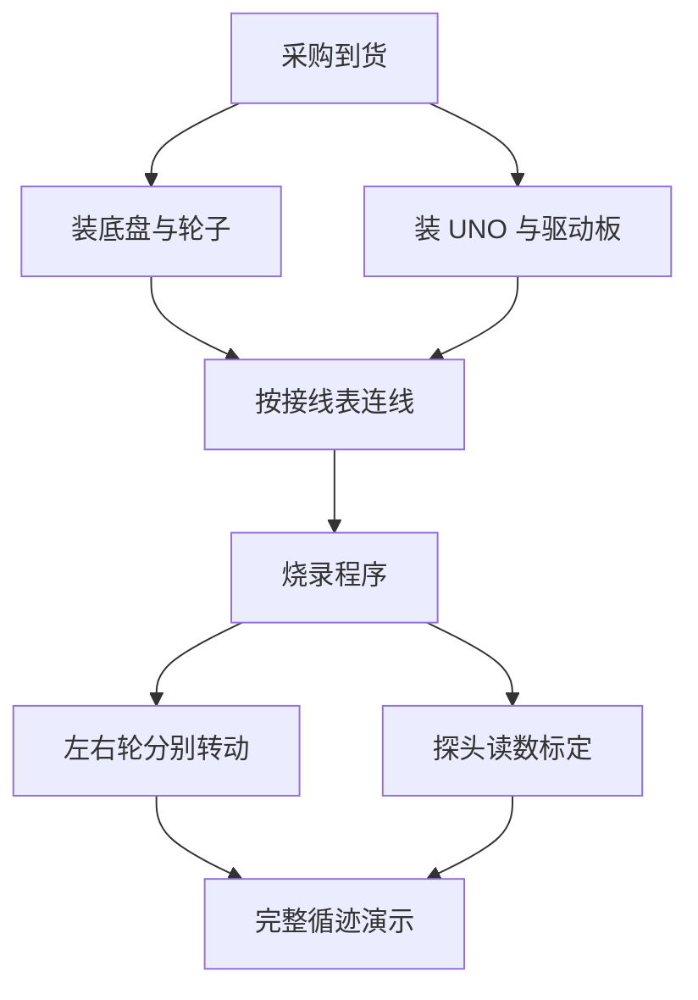

# 六维拆解总表（循迹小车）

| 字段 | 值 |
|---|---|
| 适用版本 | v1.0（UNO R3 + L298N + 2 路循迹） |
| 最后更新 | 2026-10-20 |
| 前置条件 | 读完 `00-总纲与路线图.md` |

## 1. 六维总表

| 维度 | 是什么 / 包含什么 | 买什么（MVP 部分） | 谁做 | 门槛（最难三步） | 降级路径 | 实现路径（件名+参数+谁做+多少钱+多久到） | 卡点 |
|---|---|---|---|---|---|---|---|
| ① 硬件电子 | UNO 主控、L298N 驱动、2 路循迹、电池盒、杜邦线 | 见 `05` 的 MVP 清单（￥65–100） | 家长 L2 / 孩子 L1 | 认引脚、辨极性、共地 | 整包套件一次买齐 | 淘宝/立创商城下单，3–5 天到货 | 极性接反烧模块 |
| ② 结构外壳 | 亚克力底盘、车轮、万向轮、螺丝；可选打印支架 | 2WD 底盘套件（￥18） | 家长 L2 / 孩子 L2 | 电机固定、探头高度一致 | 全用市售件，不打印 | 套件自带；想要外观再嘉立创 3D 打印 ￥10–30 | 探头太高看不清线 |
| ③ 固件 | Arduino 示例程序（循迹判断逻辑） | 0 元（本站示例） | 家长 L2 / 孩子 L3 | 装 IDE、选端口、上传 | 用 mBlock 积木版，不写代码 | 照 `../../firmware/README.md` 操作，10 分钟 | CH340 驱动/端口选错 |
| ④ 上位机软件 | 串口监视器 / mBlock（可选蓝牙 App） | 0 元 | 家长 L2 | 认串口、读数值 | 只用 Arduino IDE 串口监视器 | 软件免费下载 | 波特率不是 9600 会乱码 |
| ⑤ 算法代码 | "看到黑线往哪拐"的判断规则（4 条 if） | 0 元 | 孩子 L2 / 家长 L1 | 理解"双探头才能纠偏" | 先用单探头跑直线，再加第二个 | 示例代码里改 4 个常量 | 阈值不对→掉线 |
| ⑥ 资料与生态 | 引脚图、接线表、例程、社区 | 0 元 | 家长 L1 | 找对型号资料 | 用 Tinkercad 在线仿真 | 见 `../99-参考资源.md` | 被网上不同接法搞混 |

> 采购明细与参考价见 `05-安全与工具采购清单.md`；打样/代做参数见 skill `references/可实现路径与外包.md`；工程参数以 `projects/line-follower-car/docs/` 为准。

## 2. 依赖关系

关键路径：**接线 → 烧录 → 标定阈值 → 完整循迹**。最容易卡的是"探头阈值"（G），环境光与高度都会影响，留足时间。

## 3. 家长技能矩阵（本项目实际需要）

| 技能 | 本项目是否需要 | 用在哪一步 | 零基础替代方案 |
|---|---|---|---|
| 焊接 | **不需要** | — | 全部用杜邦线插接 |
| 烧录固件 | 需要（简单） | M1/M2 | 装 Arduino IDE 点"上传"；或用 mBlock 积木 |
| 命令行 | 不需要 | — | 全图形化操作 |
| 3D 打印 | 不需要 | 可选装饰 | 跳过；用扎带+热熔胶固定探头 |
| 金属加工 | 不需要 | — | — |
| 调试排错 | **必须**（无法外包） | 全程 | 按 `04-验收与展示.md` 的排查顺序做 |

## 4. Top 卡点清单（提前预防）

| # | 卡点 | 现象 | 预防手段 | 出现后先查什么 |
|---|---|---|---|---|
| 1 | 电源极性接反 | 上电不亮/发热/烧模块 | 红线对 12V、黑线对 GND，接完复述一遍 | 断电，用万用表核对极性 |
| 2 | 主控被电机拉重启 | 一给油就重启、行为乱 | 电机与主控分开供；电池盒并联 470–1000μF 电容 | 电池是否够电、是否共地 |
| 3 | 探头离地太高 | 对着黑线也说"白" | 装到离地 8–12mm 并排同高 | 用纸片比高度，调电位器 |
| 4 | 左右电机接反 | 原地打转/往反向走 | 接完先单测左右轮方向 | 对调同一电机两根线 |
| 5 | 阈值没标定 | 直线也乱拐、频繁掉线 | 先在串口读黑白数值再定阈值 | 读 A0/A1 数值范围 |

## 5. 与工程文档的对应关系

| 本手册章节 | 对应工程文档 |
|---|---|
| ① 硬件电子 | `projects/line-follower-car/hardware/` |
| ② 结构外壳 | `projects/line-follower-car/enclosure/` |
| ③ 固件 | `projects/line-follower-car/firmware/` |
| ④ 上位机软件 | `projects/line-follower-car/software/` |
| ⑤ 算法代码 | `projects/line-follower-car/code/` |
| ⑥ 资料与生态 | `projects/line-follower-car/docs/99-参考资源.md` |
