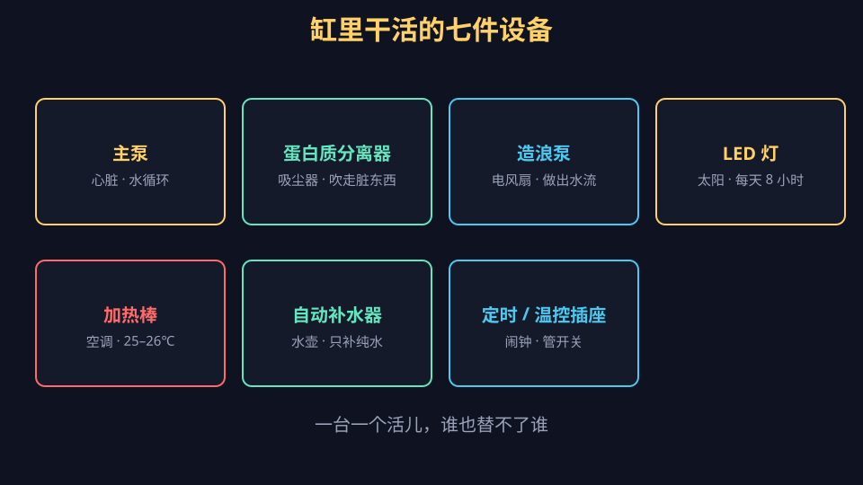

<!--
知识卡 K05-04 · 泡沫把脏东西带走（蛋白质分离器）
-->

# 知识卡 · 泡沫带走脏东西（代号贴纸：K05-04）

> 打印建议：A5 横向；正面给孩子看，背面给家长看。

## 正面（给孩子看）

### ① 看到什么
缸角落那个小机器，一直往杯子里吐黄色的泡泡。

### ② 先猜
它在做什么？

- A. 在给水打气
- B. 在把脏东西装进泡泡里扔掉

### ③ 动手验证（家里就能做，5 分钟）

1. 一杯清水，加一小勺牛奶（当"脏东西"）
2. 用吸管使劲往里吹气，吹出很多泡
3. 等泡破了看：水面上浮着一层沫，沫比水脏

### ④ 它叫什么

- 外号：缸里的肺
- 正式名：**蛋白质分离器**（简称蛋分）
- 一句话：它把脏东西粘在泡泡上，推到杯子里

### ⑤ 还在哪见过

- 家里：煮豆浆时上面那层沫、肥皂泡带走油污
- 外面：海里浪打出的白沫、洗衣机的泡沫

---

## 背面（给家长看）

| 项 | 内容 |
|---|---|
| 这张卡想让孩子明白 | 不用药、不用换水也能"捞脏东西"，靠的是泡泡把脏物带上来 |
| ② 的引导 | 让他先看那杯黄水，再想"这些东西去哪了" |
| ③ 的预期结果 | 泡沫破后水面有灰白浮沫；看不到时多加一点牛奶 |
| 适合档位 | L1 说现象 / L2 换不同液体再试 / L3 讲清"为什么泡沫能抓脏东西" |
| 常见误解 | 以为蛋分是"过滤器"；其实它不打捞固体，只带走溶解的有机物 |
| 延伸追问 | 1）为什么新缸打不出泡？ 2）杯子里的黄水该多久倒一次？ 3）没有蛋分行不行？ |
| 线索记录 | 日期 __ ／ 现象 __ ／ 结论 __ |

> 集卡规则：本卡盖 1 枚章；"设备"主题集满 3 张发称号「设备员」。
