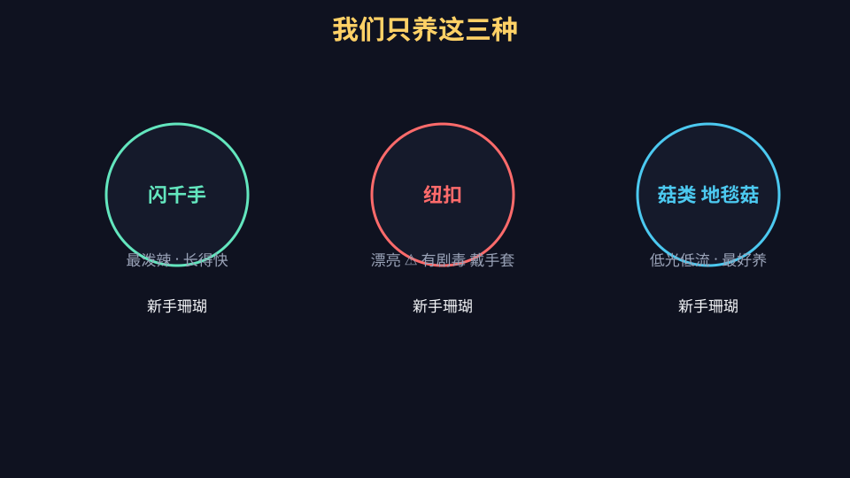

<!--
知识卡 K05-05 · 水要动起来（造浪）
-->

# 知识卡 · 水要动起来（代号贴纸：K05-05）

> 打印建议：A5 横向；正面给孩子看，背面给家长看。

## 正面（给孩子看）

### ① 看到什么
缸里的水一直在晃，珊瑚的小手跟着水一摆一摆。

### ② 先猜
水不动，珊瑚会怎么样？

- A. 没关系，安静点更好
- B. 它会没东西吃，还会闷坏

### ③ 动手验证（家里就能做，5 分钟）

1. 两碗水，各放一片碎菜叶
2. 一碗不动，一碗用勺子慢慢画圈搅
3. 你看到：搅的那碗，菜叶转起来碰到了更多水

### ④ 它叫什么

- 外号：给水扇风
- 正式名：**水流 / 造浪**
- 一句话：水流动，珊瑚才有饭吃、才不被闷住

### ⑤ 还在哪见过

- 家里：电风扇转着屋里才不闷、鱼缸加氧泵
- 外面：海浪拍岸、河水流过石头

---

## 背面（给家长看）

| 项 | 内容 |
|---|---|
| 这张卡想让孩子明白 | 水不是"越静越好"，海水缸需要适度水流 |
| ② 的引导 | 联系"屋里不开窗会闷"，先让他建立直觉 |
| ③ 的预期结果 | 搅动那碗菜叶转起来；看不到时搅慢一点、再快一点对比 |
| 适合档位 | L1 说现象 / L2 比较快慢两种搅法 / L3 讲清"水流为什么能带食物" |
| 常见误解 | 以为水流越大越好；实际太猛会吹跑小鱼、吹倒珊瑚 |
| 延伸追问 | 1）水流太大会怎么样？ 2）造浪为什么能调档？ 3）珊瑚的"手"是什么？ |
| 线索记录 | 日期 __ ／ 现象 __ ／ 结论 __ |

> 集卡规则：本卡盖 1 枚章；"设备"主题集满 3 张发称号「设备员」。
