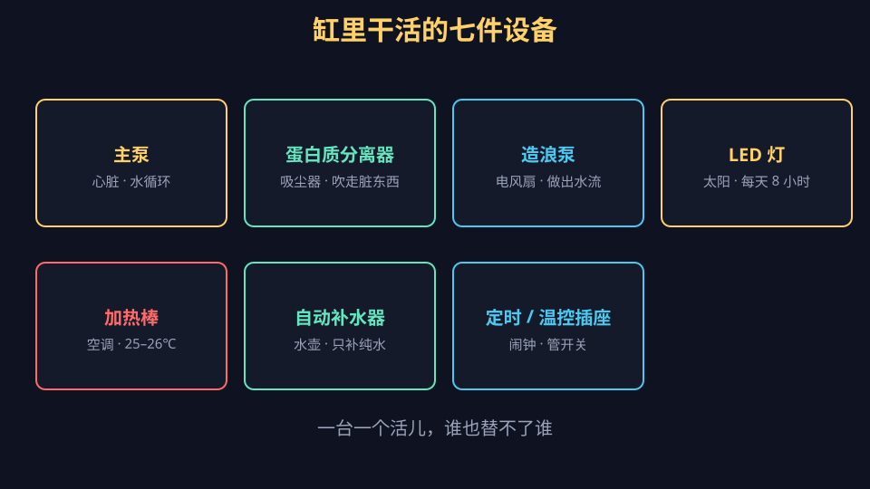

<!--
知识卡 K05-06 · 鱼也要空调（水温与加热棒）
-->

# 知识卡 · 鱼也要空调（代号贴纸：K05-06）

> 打印建议：A5 横向；正面给孩子看，背面给家长看。

## 正面（给孩子看）

### ① 看到什么
缸里那根白棒子，一会儿热一会儿不热，水温表一直指着 25。

### ② 先猜
海水也怕冷怕热吗？

- A. 不怕，水那么多
- B. 怕，温度一变鱼就难受

### ③ 动手验证（家里就能做，10 分钟）

1. 两个杯子都放温水，插温度计
2. 一个放进冰箱冷藏格，一个放在桌上
3. 3 分钟后看：冰箱里的温度掉了很多

### ④ 它叫什么

- 外号：鱼的空调
- 正式名：**加热棒 + 温控**
- 一句话：水温要一直待在 25–26℃，太冷太热鱼都生病

### ⑤ 还在哪见过

- 家里：空调恒温、热水器的温控、冰箱的恒温
- 外面：夏天湖面比岸上凉、游泳池有加热

---

## 背面（给家长看）

| 项 | 内容 |
|---|---|
| 这张卡想让孩子明白 | 温度要"稳住"，不是"越高越好"；稳住靠的是恒温控制 |
| ② 的引导 | 用身体感受做类比："你从空调房出去会不会不舒服？" |
| ③ 的预期结果 | 冷藏那杯温度明显下降；看不到时多等 2 分钟 |
| 适合档位 | L1 说现象 / L2 每 2 分钟记一次数 / L3 讲清"为什么要双保险" |
| 常见误解 | 以为加热棒会一直加热；实际它到温度就停，靠温控插座再加一道保险 |
| 延伸追问 | 1）为什么要有两个插头管温度？ 2）夏天房间太热怎么办？ 3）温度计和加热棒谁说了算？ |
| 线索记录 | 日期 __ ／ 现象 __ ／ 结论 __ |

> 集卡规则：本卡盖 1 枚章；"设备"主题集满 3 张发称号「设备员」。
