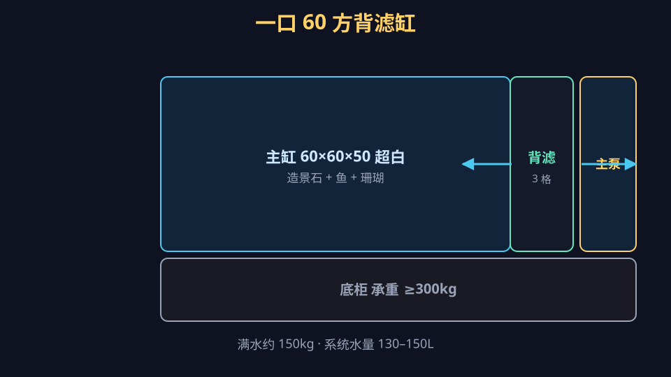
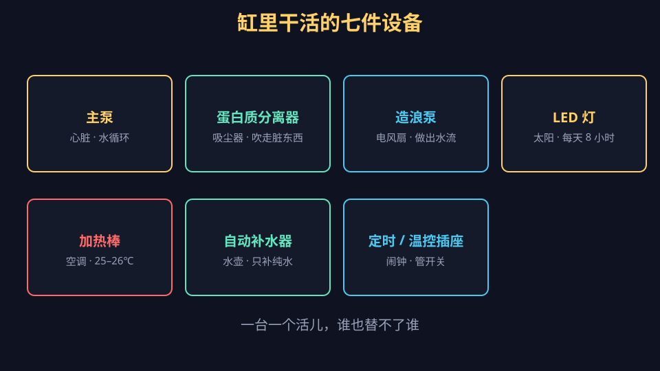
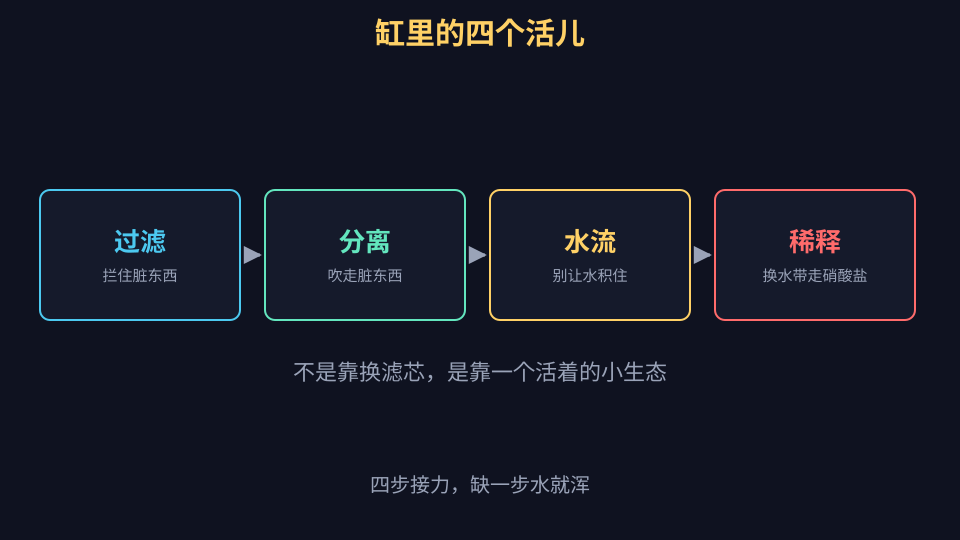
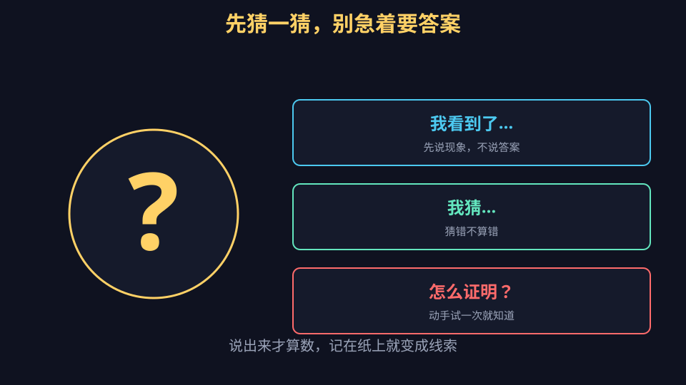
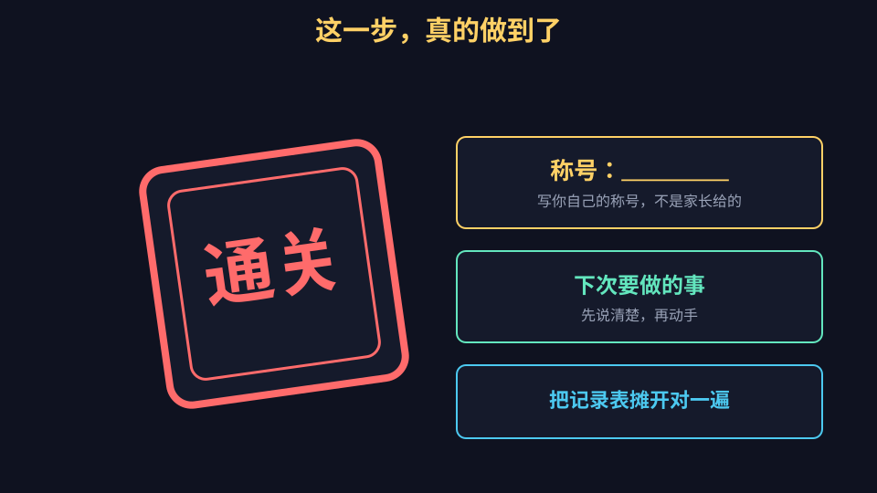

<!--
40cm 背滤海缸（小丑鱼练手版）· 第 1 课课件
构建：python3 .trae/skills/stem-project-onboarding/scripts/build_slides.py projects/nano-reef-40/docs/儿童课程/*/课件.md --strict
-->

<!-- layout: title -->
# 我们的海缸

今天认识一个会自己转的小水世界
<!-- notes: 开场 30 秒。只说"今天要认识一口缸"，不讲原理。 -->

---
<!-- layout: image -->
## 先看一样东西

<!-- notes: 给孩子看 10 秒，问"你看到了什么"。不提示、不补充，让他自己说。 -->

---
<!-- layout: big -->
## 猜一猜
水会往哪边流？
<!-- notes: 让孩子先猜再动手。答案不写出来；猜错就说"那我们试试看"。 -->

---
<!-- layout: two-col -->
### 干活的三位
- 泵：把水推回去
- 蛋分：把脏东西打泡带走
- 造浪：让水动起来
### 照顾的三位
- 灯：给珊瑚太阳
- 加热棒：给水盖被子

<!-- notes: 一次只讲一个。每个零件都问"它像家里的什么"（泵像心脏、灯像太阳）。 -->

---
<!-- layout: image -->
## 水的一圈路

<!-- notes: 用手指从背滤第一格描到出水格，再描回主缸。让孩子跟着描一遍。 -->

---
## 动手（3 步）
1. 找到贴着 ① 的插头
2. 插进排插
3. 喊我，我按漏电开关

<!-- notes: 一次只做这一件事。插电由家长单独执行，孩子在安全距离外。 -->

---
<!-- layout: big -->
## 通关条件
水面动起来 = 过关
<!-- notes: 让孩子自己判断过没过。不评价快慢。过关就盖章。 -->

---
<!-- layout: two-col -->
### 我们发现的
- 水面在动
- 有细细的气泡
### 记下的线索
- 第一次没动，因为水位太低

<!-- notes: 收尾 3 问：今天成功的标志 / 哪里最麻烦 / 下次想改哪里。 -->

---
<!-- layout: image -->
## 想一想

<!-- notes: 三个句式轮流用：我看到了…（说现象）／我猜…（猜错不算错）／怎么证明？ -->

---
<!-- layout: title -->
# 恭喜过关
你现在是「材料员」

<!-- notes: 盖章、发称号。预告下一关：把水变成海水。留个钩子再下课。 -->
