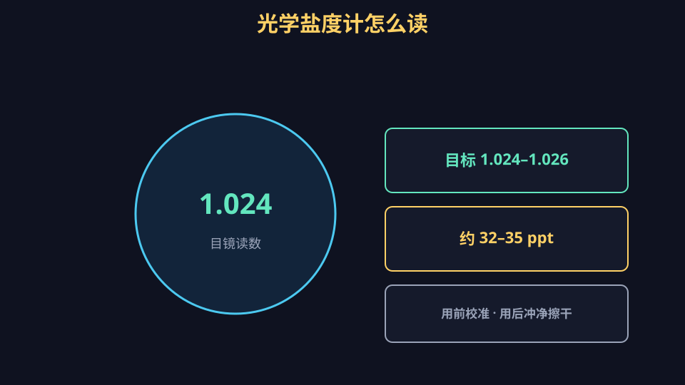

<!--
知识卡 K05-01 · 海水为什么是咸的（盐度）
写给孩子看，可打印，一页一张。五步：看到什么 → 先猜 → 动手验证 → 它叫什么 → 还在哪见过。
-->

# 知识卡 · 海水为什么咸（代号贴纸：K05-01）

> 打印建议：A5 横向；正面给孩子看，背面给家长看。

## 正面（给孩子看）

### ① 看到什么
一杯清水加一勺盐，搅一搅，盐不见了，水却变咸了。

### ② 先猜
盐跑哪去了？

- A. 盐消失了
- B. 盐还在水里，只是看不见

### ③ 动手验证（家里就能做，5 分钟）

1. 一杯温水，加两勺盐，搅到看不见
2. 请家长把盐水倒进锅里，小火煮干
3. 你看到：锅底留一层白霜，尝一下——是咸的

### ④ 它叫什么

- 外号：水的咸淡
- 正式名：**盐度**
- 一句话：海水像一碗汤，盐的多少看得见

### ⑤ 还在哪见过

- 家里：煮面条的水、腌咸菜的水
- 外面：海水、盐湖、退潮后石头上的白霜

---

## 背面（给家长看）

| 项 | 内容 |
|---|---|
| 这张卡想让孩子明白 | 盐溶解了但没消失，所以海水要"配"，不能随手加 |
| ② 的引导 | 等 10 秒再给线索；答错就说"那我们把它煮干看看" |
| ③ 的预期结果 | 锅底出现白色盐霜；看不到时先查是否煮干 |
| 适合档位 | L1 说现象 / L2 换一勺盐再比一次 / L3 讲给家人听 |
| 常见误解 | 以为"看不见就是没有了"；实际是溶解，煮干还能拿回来 |
| 延伸追问 | 1）为什么死海人浮着不下沉？ 2）雨水是咸的吗？ 3）为什么不能用自来水配海水？ |
| 线索记录 | 日期 __ ／ 现象 __ ／ 结论 __ |

> 集卡规则：本卡盖 1 枚章；"水"主题集满 3 张发称号「配水员」。
