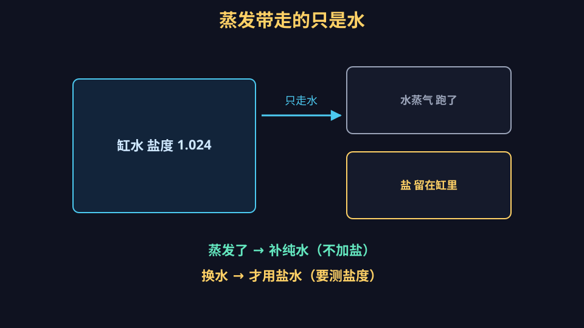

<!--
知识卡 K05-02 · 蒸发只带走水（补水只补纯水）
-->

# 知识卡 · 水会自己跑掉（代号贴纸：K05-02）

> 打印建议：A5 横向；正面给孩子看，背面给家长看。

## 正面（给孩子看）

### ① 看到什么
缸里的水一天比一天少，可摸起来还是咸的。

### ② 先猜
跑掉的，是水还是盐？

- A. 水和盐一起跑掉了
- B. 只有水跑了，盐留在缸里

### ③ 动手验证（家里就能做，隔一天看）

1. 两个杯子里都放盐水，一个放窗边、一个盖盖子
2. 第二天看：没盖的那杯水少了
3. 再尝一下——还是咸的，盐一点没少

### ④ 它叫什么

- 外号：水偷偷溜走
- 正式名：**蒸发**
- 一句话：水会变成看不见的汽跑掉，盐跑不掉

### ⑤ 还在哪见过

- 家里：晾干的衣服、锅盖上的水珠、咸菜坛子要加水
- 外面：雨后的水洼变干、海边晒盐

---

## 背面（给家长看）

| 项 | 内容 |
|---|---|
| 这张卡想让孩子明白 | 蒸发只带走水，所以**补水只能补纯水**，补盐水会越补越咸 |
| ② 的引导 | 先让他猜，再带他尝那杯少了的盐水 |
| ③ 的预期结果 | 无盖那杯水位下降且更咸；看不到时延长到 2–3 天 |
| 适合档位 | L1 说现象 / L2 每天量水位画一画 / L3 讲清"为什么补的不是海水" |
| 常见误解 | 以为"水少了要补海水"；实际补海水等于往汤里继续加盐 |
| 延伸追问 | 1）为什么夏天水位掉得更快？ 2）补水桶为什么单独一个？ 3）盐度计为什么每天都要看？ |
| 线索记录 | 日期 __ ／ 现象 __ ／ 结论 __ |

> 集卡规则：本卡盖 1 枚章；"水"主题集满 3 张发称号「配水员」。
