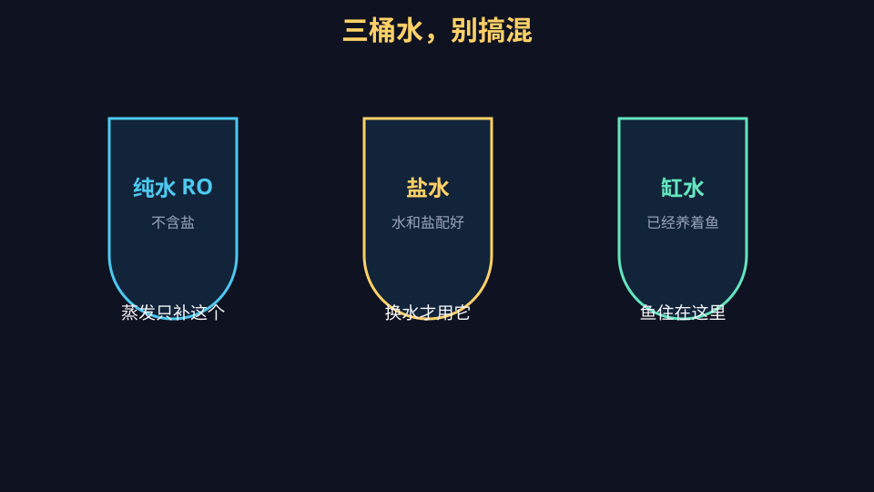
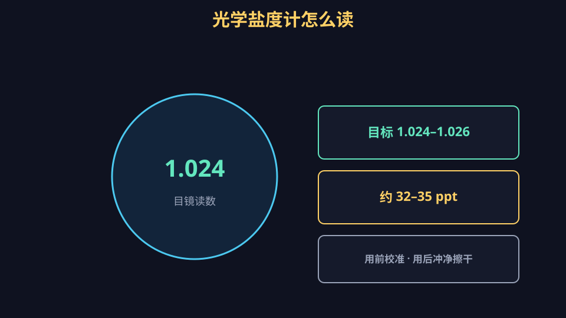
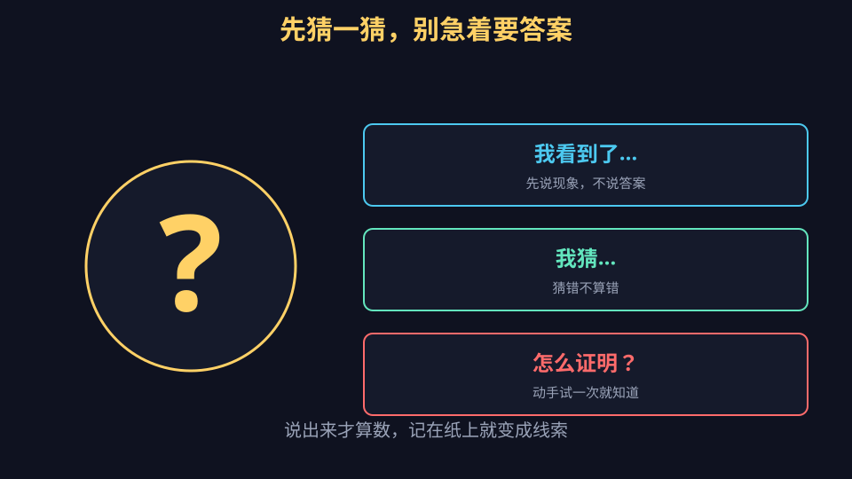
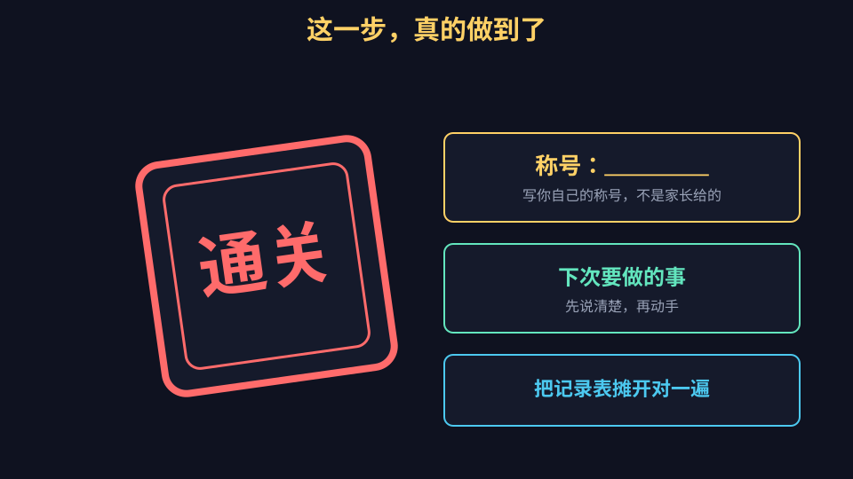

<!--
40cm 背滤海缸（小丑鱼练手版）· 第 2 课课件
构建：python3 .trae/skills/stem-project-onboarding/scripts/build_slides.py projects/nano-reef-40/docs/儿童课程/*/课件.md --strict
-->

<!-- layout: title -->
# 三桶水

淡水、纯水、海水，长得都像水
<!-- notes: 开场 30 秒。只说今天要配一桶"海水"，不讲原理。 -->

---
<!-- layout: image -->
## 先看一样东西

<!-- notes: 看 10 秒，问"哪一桶能养小丑鱼"。不提示，让他猜。 -->

---
<!-- layout: big -->
## 猜一猜
加一勺盐，水会变多吗？
<!-- notes: 先猜再动手。答错就说"那我们称一称看"。 -->

---
## 三种水
- 淡水：不能养鱼
- 纯水：用来配海水
- 海水：纯水加盐

<!-- notes: 强调"纯水不是矿泉水"——矿泉水里的矿物质会让水质跑偏。 -->

---
## 动手（3 步）
1. 量出 30 升纯水
2. 加 1 公斤珊瑚盐
3. 搅到看不见盐粒

<!-- notes: 分次加盐，每加一次搅到全溶。孩子负责数数、看盐粒没了没。 -->

---
<!-- layout: image -->
## 怎么知道够了

<!-- notes: 盐度计像"汤的咸淡计"。读数要在 1.024–1.026 之间，1.025 最好。 -->

---
<!-- layout: big -->
## 通关条件
盐度计读 1.025 = 过关
<!-- notes: 让孩子自己读刻度、自己判断。读对了就盖章。 -->

---
<!-- layout: two-col -->
### 我们发现的
- 盐化开后水变清
- 桶有点温温的
### 记下的线索
- 第一桶差一点，又补了半勺盐

<!-- notes: 收尾 3 问。重点问"为什么加盐水会变热"。 -->

---
<!-- layout: image -->
## 想一想

<!-- notes: 问：如果加太多盐，鱼会怎么样？先猜，下节课验证。 -->

---
<!-- layout: title -->
# 恭喜过关
你现在是「配水员」

<!-- notes: 盖章发称号。预告下一关：水配好了，为什么还不能放鱼？ -->
