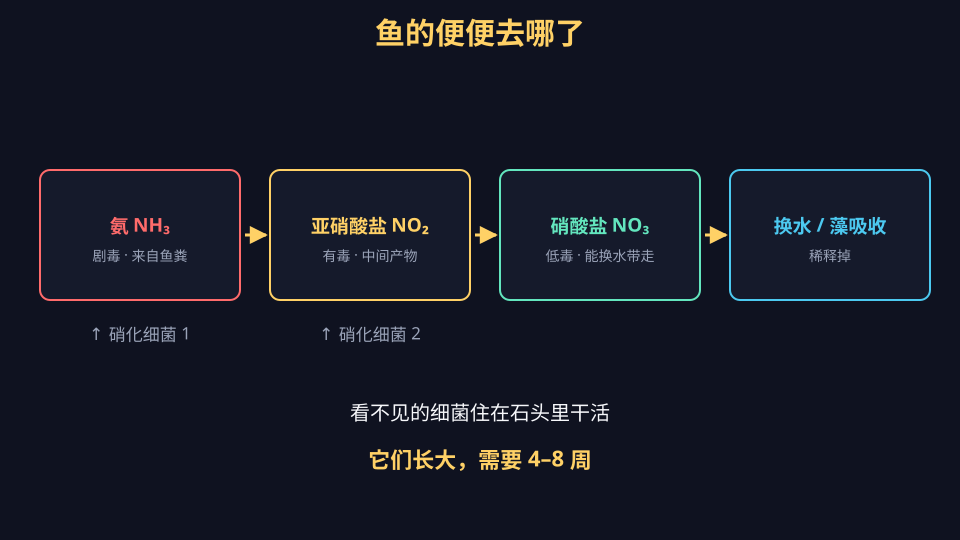

<!--
知识卡 K05-03 · 看不见的清洁工（硝化细菌）
-->

# 知识卡 · 看不见的清洁工（代号贴纸：K05-03）

> 打印建议：A5 横向；正面给孩子看，背面给家长看。

## 正面（给孩子看）

### ① 看到什么
缸里最脏的水，过几周自己变清了，可我们什么都没做。

### ② 先猜
是谁把脏东西吃掉了？

- A. 是被水冲走了
- B. 有一群看不见的小工人住在滤材里

### ③ 动手验证（家里就能做，等 3 天）

1. 一小杯水加一点牛奶（当"脏东西"），贴上"1 号"
2. 另一杯只放水，贴上"2 号"
3. 放 3 天：1 号变浑还发臭，2 号没变

### ④ 它叫什么

- 外号：缸里的隐形清洁工
- 正式名：**硝化细菌**
- 一句话：它们住在滤材的小孔里，专门吃有毒的氨

### ⑤ 还在哪见过

- 家里：酸奶里的菌、发面团的酵母、下水道的"生物膜"
- 外面：池塘能自我变清、土壤里的微生物

---

## 背面（给家长看）

| 项 | 内容 |
|---|---|
| 这张卡想让孩子明白 | 缸能自己变干净，是因为有"活的东西"在干活，所以要给它时间 |
| ② 的引导 | 强调"看不见不等于没有"，就像空气看不见但我们活着 |
| ③ 的预期结果 | 牛奶水变浑发臭；这里是**反例**，说明没有细菌的水只会越放越坏 |
| 适合档位 | L1 说现象 / L2 一起闻一闻对比 / L3 讲清细菌为什么住在滤材里 |
| 常见误解 | 以为"水清就是干净"；实际清澈的水也可能有毒（氨超标） |
| 延伸追问 | 1）为什么细菌要住在有洞的滤材上？ 2）为什么新缸容易浑？ 3）为什么不能天天换水代替细菌？ |
| 线索记录 | 日期 __ ／ 现象 __ ／ 结论 __ |

> 集卡规则：本卡盖 1 枚章；"养水"主题集满 2 张（本卡 + K05-09）发称号「养水师」。
