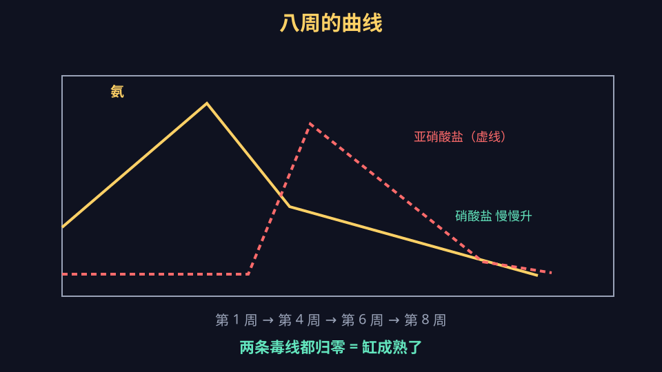

<!--
知识卡 K05-09 · 为什么要等这么久（氮循环）
-->

# 知识卡 · 为什么要等这么久（代号贴纸：K05-09）

> 打印建议：A5 横向；正面给孩子看，背面给家长看。

## 正面（给孩子看）

### ① 看到什么
水配好了，可大人说要等一个月才能放鱼。

### ② 先猜
等的是水，还是别的什么？

- A. 等水变清
- B. 等看不见的小工人长大

### ③ 动手验证（家里就能做，隔 3 天看一次）

1. 三杯水，每天各滴一滴"脏东西"（牛奶），分别标 1、2、3
2. 1 号当天看、2 号放 3 天看、3 号放 6 天看
3. 你看到：放得越久，水越不容易浑——小工人越长越多

### ④ 它叫什么

- 外号：垃圾流水线
- 正式名：**氮循环**
- 一句话：有毒的氨，被两步变成不毒的硝酸盐

### ⑤ 还在哪见过

- 家里：化粪池、堆肥、下水道的净化
- 外面：池塘自己能变清、湿地把脏水洗干净

---

## 背面（给家长看）

| 项 | 内容 |
|---|---|
| 这张卡想让孩子明白 | 这个月不是在等水，是在等**细菌队伍长大**；这是不能加速的事 |
| ② 的引导 | 强调"看不见的过程也要花时间"，就像种花等发芽 |
| ③ 的预期结果 | 放到 6 天的水更难变浑；看不到时把观察延长到一周 |
| 适合档位 | L1 说现象 / L2 每 2 天测一次氨氮 / L3 讲出氨→亚硝酸盐→硝酸盐三步 |
| 常见误解 | 以为"水清就能放鱼"；实际要等氨和亚硝酸盐都归零 |
| 延伸追问 | 1）硝酸盐太多了怎么办？ 2）为什么水温低要等更久？ 3）怎么知道可以放鱼了？ |
| 线索记录 | 日期 __ ／ 现象 __ ／ 结论 __ |

> 集卡规则：本卡盖 1 枚章；"养水"主题集满 2 张（本卡 + K05-03）发称号「养水师」。
