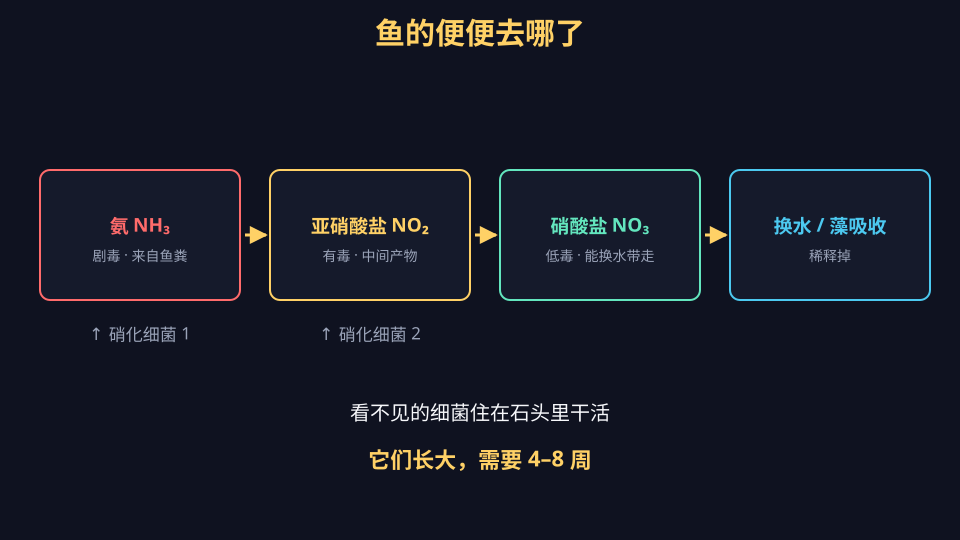
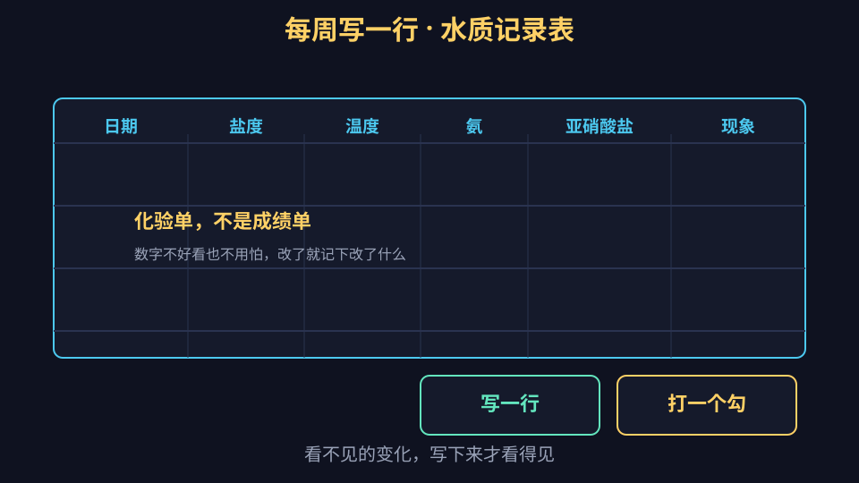
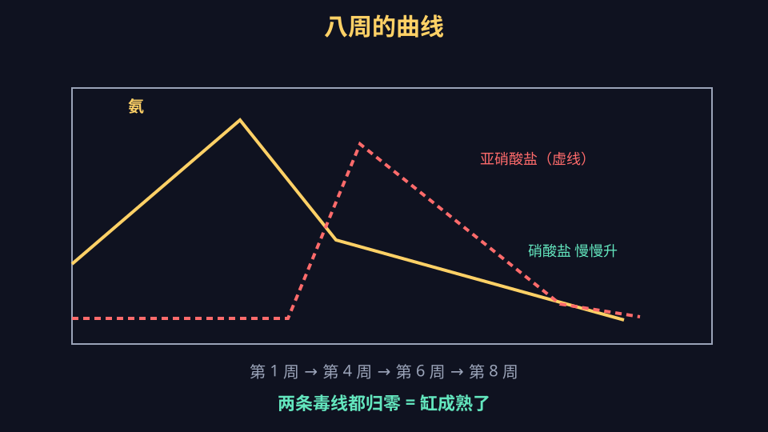
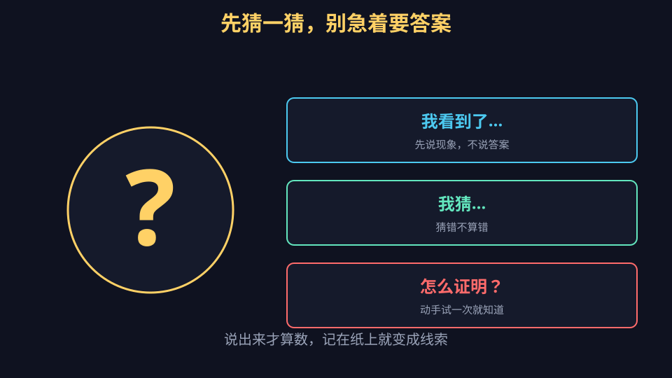
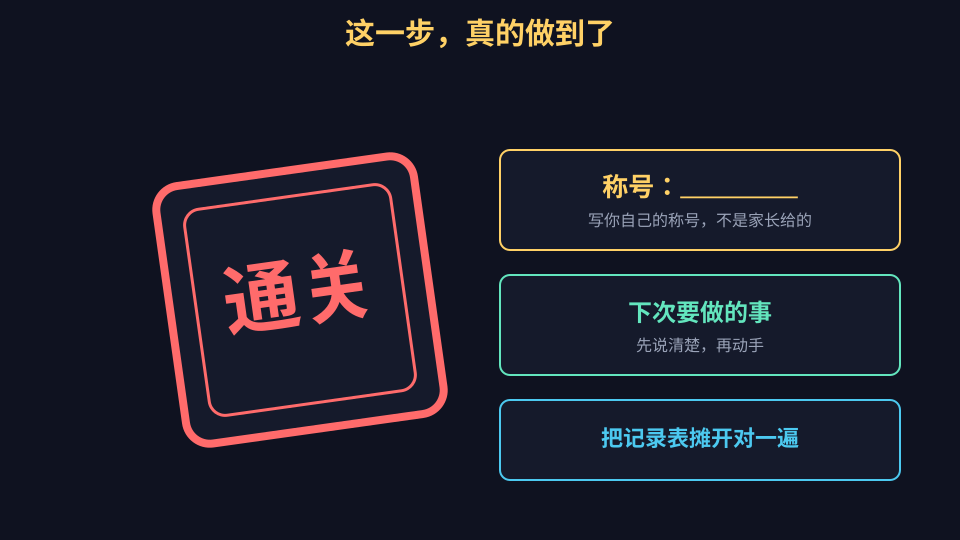

<!--
40cm 背滤海缸（小丑鱼练手版）· 第 3 课课件
构建：python3 .trae/skills/stem-project-onboarding/scripts/build_slides.py projects/nano-reef-40/docs/儿童课程/*/课件.md --strict
-->

<!-- layout: title -->
# 为什么还要等

水配好了，鱼却要等 4 到 8 周
<!-- notes: 开场 30 秒。今天讲一件"看不见的事"，是本项目最重要的一课。 -->

---
<!-- layout: image -->
## 先看一样东西

<!-- notes: 看 10 秒，问"你看见细菌了吗"。让孩子体会"看不见不等于没发生"。 -->

---
<!-- layout: big -->
## 猜一猜
鱼排的尿，谁吃掉？
<!-- notes: 先猜再讲。不急着给答案。 -->

---
## 三步流水线
1. 氨：有毒
2. 亚硝酸盐：更毒
3. 硝酸盐：换水带走

<!-- notes: 用"垃圾处理流水线"打比方：氨→亚硝酸盐→硝酸盐，一步步变无害。 -->

---
<!-- layout: image -->
## 干活的是谁
看不见的清洁工：硝化细菌

<!-- notes: 细菌住在滤材的孔里，专门吃有毒的氨。它们要慢慢长，急不来。 -->

---
## 动手（3 步）
1. 滴试剂进小试管
2. 比色卡对颜色
3. 把数字写进表

<!-- notes: 每 2 天测一次。孩子读颜色、报数字、家长记。 -->

---
<!-- layout: image -->
## 要等多久

氨先升高，然后归零
<!-- notes: 看曲线：先高后低，最后两条都到 0。这就叫"水养好了"。 -->

---
<!-- layout: big -->
## 通关条件
氨 0，亚硝酸盐 0 = 过关
<!-- notes: 连续两次都是 0 才算过关。这是不能加速的一关，也是最好的耐心课。 -->

---
<!-- layout: two-col -->
### 我们发现的
- 第 3 天数字最高
- 第 22 天变 0 了
### 记下的线索
- 水温低的时候，变 0 更慢

<!-- notes: 收尾 3 问。重点问"我们凭什么说现在可以放鱼了"。 -->

---
<!-- layout: image -->
## 想一想

<!-- notes: 问：如果今天放鱼，会怎么样？让他自己推断，不吓唬。 -->

---
<!-- layout: title -->
# 恭喜过关
你现在是「养水师」

<!-- notes: 盖章发称号。预告下一关：先请清洁工，再请小丑鱼。 -->
