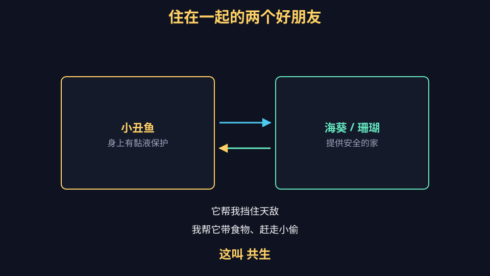

<!--
知识卡 K05-07 · 住在一起的好朋友（小丑鱼的家）
-->

# 知识卡 · 住在一起的好朋友（代号贴纸：K05-07）

> 打印建议：A5 横向；正面给孩子看，背面给家长看。

## 正面（给孩子看）

### ① 看到什么
小丑鱼总待在那个石头洞边，别的地方它不常去。

### ② 先猜
它为什么老待在一块地方？

- A. 它懒
- B. 那是它的家，它要守住

### ③ 动手验证（家里就能做，10 分钟）

1. 用纸盒做两个"洞"，放在小动物玩具（或小球）旁边
2. 把玩具放进其中一个洞
3. 你看到：它下次还会回到同一个洞——熟悉的地方更安全

### ④ 它叫什么

- 外号：鱼的小房间
- 正式名：**领地 / 躲避处**
- 一句话：有洞有角落，鱼才安心，才不打架

### ⑤ 还在哪见过

- 家里：猫只睡自己的窝、你只坐自己的座位
- 外面：鸟占一根树枝、狗要在门口站岗

---

## 背面（给家长看）

| 项 | 内容 |
|---|---|
| 这张卡想让孩子明白 | 鱼需要"自己的地盘"；造景不是装饰，是给鱼的家 |
| ② 的引导 | 联系孩子的"自己的床/座位"，一下就懂 |
| ③ 的预期结果 | 玩具反复回到同一洞；这里验证的是"熟悉=安全"的直觉 |
| 适合档位 | L1 说现象 / L2 观察两条鱼各自的位置 / L3 讲清"为什么两条鱼要一大一小" |
| 常见误解 | 以为鱼游来游去没脾气；实际小丑鱼有很强的领地意识 |
| 延伸追问 | 1）为什么两条鱼要一大一小？ 2）为什么先放螺后放鱼？ 3）躲避越多越不容易打架吗？ |
| 线索记录 | 日期 __ ／ 现象 __ ／ 结论 __ |

> 集卡规则：本卡盖 1 枚章；"生物"主题集满 2 张（本卡 + K05-08）发称号「引鱼师」。
