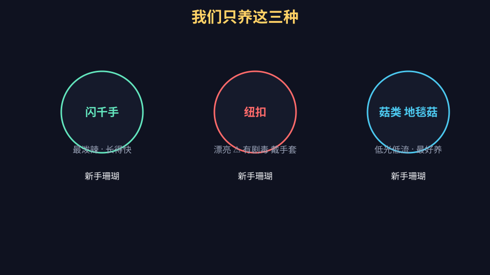

<!--
知识卡 K05-08 · 珊瑚不是石头，是动物
-->

# 知识卡 · 珊瑚是动物（代号贴纸：K05-08）

> 打印建议：A5 横向；正面给孩子看，背面给家长看。

## 正面（给孩子看）

### ① 看到什么
一朵"小花"粘在石头上，你碰一下水，它就缩回去了。

### ② 先猜
珊瑚是石头、植物，还是动物？

- A. 石头
- B. 动物

### ③ 动手验证（家里就能做，5 分钟）

1. 摸一下家里的绿植叶子——它不会躲
2. 再用手在鱼缸（或水盆）水面上快速晃一下
3. 你看到：珊瑚"花"缩了——会躲的，是动物

### ④ 它叫什么

- 外号：会开花的石头
- 正式名：**珊瑚（珊瑚虫）**
- 一句话：会抓东西吃、会躲，就是动物

### ⑤ 还在哪见过

- 家里：含羞草被碰会合（但那是植物）
- 外面：海里成片的珊瑚礁、石头上的海葵

---

## 背面（给家长看）

| 项 | 内容 |
|---|---|
| 这张卡想让孩子明白 | "会动会反应"是判断动物的重要线索；珊瑚礁是活的 |
| ② 的引导 | 别急着给答案，先让孩子自己碰一碰、晃一晃 |
| ③ 的预期结果 | 珊瑚缩回触手；看不到时说明它可能不开，先查水流与光照 |
| 适合档位 | L1 说现象 / L2 比一比"碰植物"与"碰珊瑚" / L3 讲清珊瑚靠共生藻吃饭 |
| 常见误解 | 以为珊瑚是石头；实际它是动物，只是一动不动的动物 |
| 延伸追问 | 1）珊瑚吃什么？ 2）它为什么需要蓝光？ 3）珊瑚变白是什么意思？ |
| 线索记录 | 日期 __ ／ 现象 __ ／ 结论 __ |

> ⚠️ 家长注意：**纽扣珊瑚含 palytoxin 剧毒**，孩子不得触碰；家长操作必须戴手套，操作后用肥皂水洗手、不揉眼。
>
> 集卡规则：本卡盖 1 枚章；"生物"主题集满 2 张发称号「引鱼师」。
