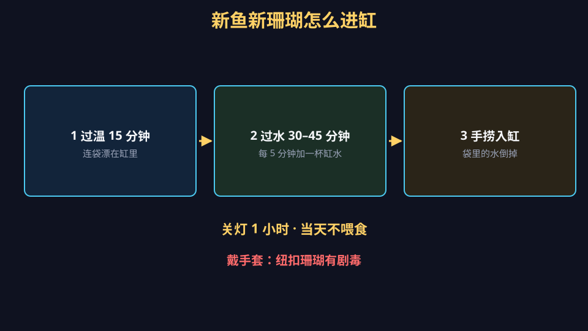

<!--
知识卡 K05-10 · 慢慢适应新家（过水）
-->

# 知识卡 · 慢慢适应新家（代号贴纸：K05-10）

> 打印建议：A5 横向；正面给孩子看，背面给家长看。

## 正面（给孩子看）

### ① 看到什么
新来的鱼，先连袋子一起漂在缸里，半小时后才放出来。

### ② 先猜
为什么不直接倒进去？

- A. 太麻烦，直接倒就行
- B. 温度和水突然变了，鱼会受不了

### ③ 动手验证（家里就能做，10 分钟）

1. 两只手，一只先泡温水、一只先泡凉水
2. 再一起放进常温水里
3. 你感觉到：泡过温水的那只手，觉得"好凉"——突然变，身体反应就大

### ④ 它叫什么

- 外号：先适应再搬家
- 正式名：**过水**
- 一句话：让温度和水的味道一点点变，鱼才不生病

### ⑤ 还在哪见过

- 家里：从空调房出门要加件外套、换季慢慢加衣服
- 外面：运动员比赛前要热身、游泳下水要慢慢下

---

## 背面（给家长看）

| 项 | 内容 |
|---|---|
| 这张卡想让孩子明白 | 变化要"慢慢来"，突然改变会让生物休克 |
| ② 的引导 | 用"手泡水"的体感类比，比讲道理有效 |
| ③ 的预期结果 | 泡过温水的手会觉得常温水凉；看不到时让孩子先描述感受 |
| 适合档位 | L1 说现象 / L2 计时 20 分钟做观察员 / L3 讲清过水为何要"分次兑水" |
| 常见误解 | 以为鱼袋直接倒进去更快；实际快反而容易死鱼 |
| 延伸追问 | 1）为什么要先漂 20 分钟？ 2）为什么要一点点兑缸水？ 3）新鱼为什么要隔离观察？ |
| 线索记录 | 日期 __ ／ 现象 __ ／ 结论 __ |

> 集卡规则：本卡盖 1 枚章；"生物"主题集满 2 张（本卡 + K05-07/08）发称号「引鱼师」。
