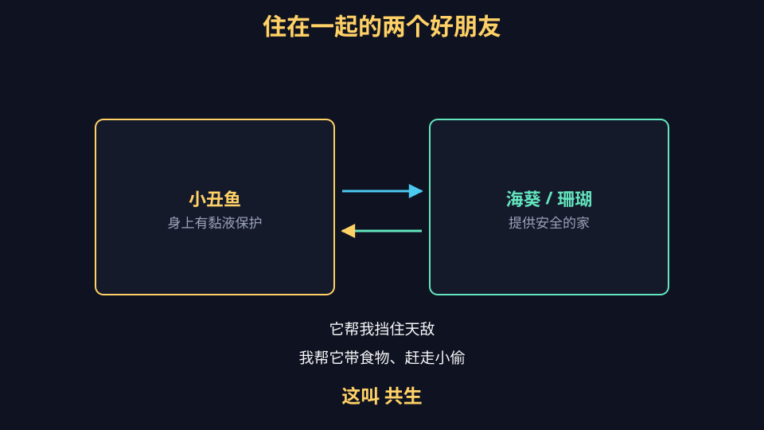
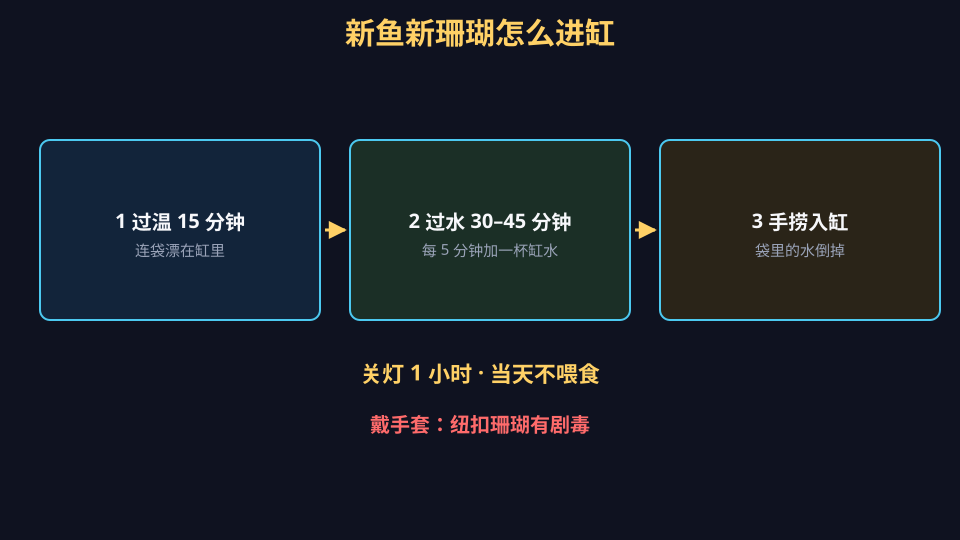
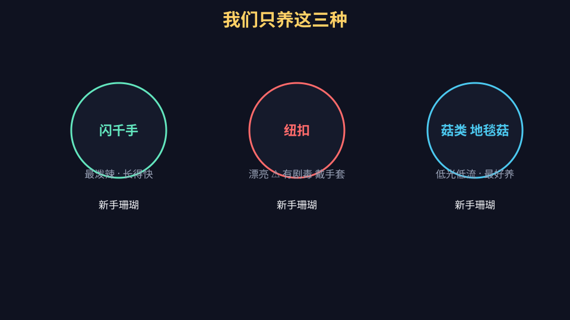
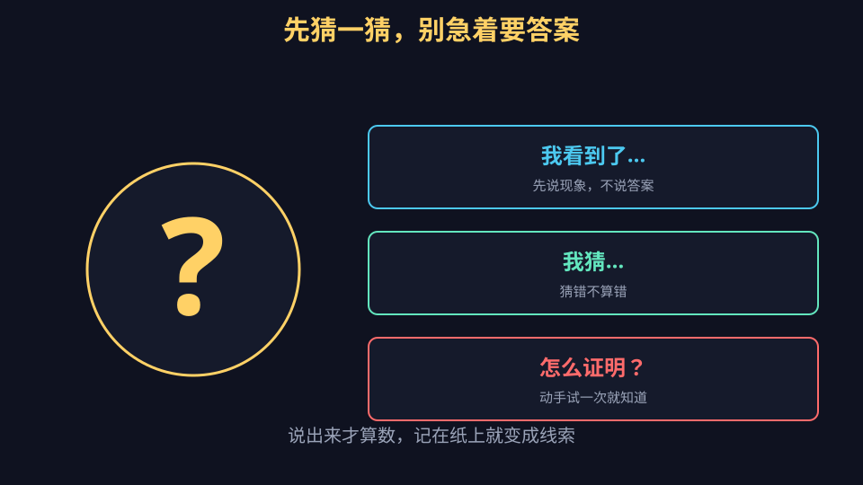
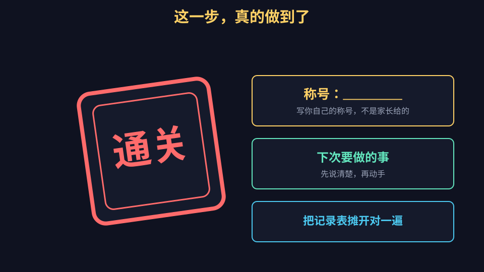

<!--
40cm 背滤海缸（小丑鱼练手版）· 第 4 课课件
构建：python3 .trae/skills/stem-project-onboarding/scripts/build_slides.py projects/nano-reef-40/docs/儿童课程/*/课件.md --strict
-->

<!-- layout: title -->
# 小丑鱼的家

今天请两位新住户进缸
<!-- notes: 开场 30 秒。今天分两步：先清洁队，隔一周再下鱼。 -->

---
<!-- layout: image -->
## 先看一样东西

<!-- notes: 看 10 秒，问"小丑鱼住在哪"。孩子多半会说海葵，我们养的是人工鱼。 -->

---
<!-- layout: big -->
## 猜一猜
先放螺，还是先放鱼？
<!-- notes: 先猜。答案是先螺——它们不制造脏东西，还负责打扫。 -->

---
## 为什么要有顺序
1. 先请清洁队
2. 一周后请鱼
3. 再两周请珊瑚

<!-- notes: 一次只加一批，让缸有时间适应。这一步最忌"一次买齐"。 -->

---
## 动手（3 步）
1. 袋子漂 20 分钟
2. 兑一点缸水
3. 轻轻放出来

<!-- notes: 这个动作叫"过水"。目的是让温度和水质慢慢一样，不然鱼会休克。 -->

---
<!-- layout: image -->
## 鱼住哪

洞里、缝隙里，都是鱼的家
<!-- notes: 有洞才不打架。小丑鱼会挑一个角落当自己的地盘。 -->

---
## 两条鱼怎么不打
- 一条大一点、一条小一点
- 同时放进缸
- 多放几个躲避

<!-- notes: 小丑鱼会变大变小来分主次；体型差明显，打架就少。 -->

---
<!-- layout: big -->
## 通关条件
鱼在缸里游一周 = 过关
<!-- notes: 一周内正常吃食、不躲死角，就算过关。 -->

---
<!-- layout: two-col -->
### 我们发现的
- 螺开始啃玻璃上的藻
- 鱼躲进左边那个洞
### 记下的线索
- 第一次水太冷，鱼不动

<!-- notes: 收尾 3 问。重点问"你觉得这是谁的家"。 -->

---
<!-- layout: image -->
## 小心这一样

纽扣珊瑚有毒，必须戴手套
<!-- notes: ⚠️ 说清：碰纽扣珊瑚要戴手套，之后用肥皂水洗手，不要揉眼。 -->

---
<!-- layout: title -->
# 恭喜过关
你现在是「引鱼师」

<!-- notes: 盖章发称号。预告最后一关：每周给缸做体检。 -->
