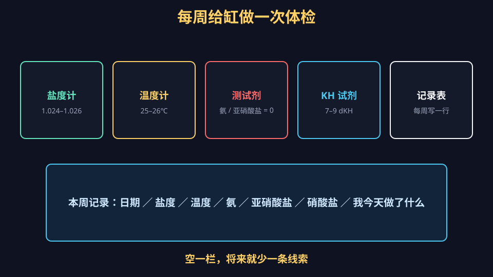
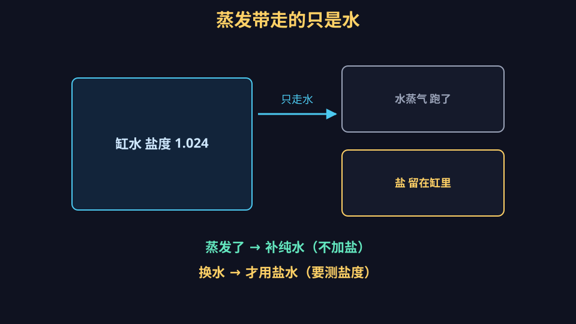
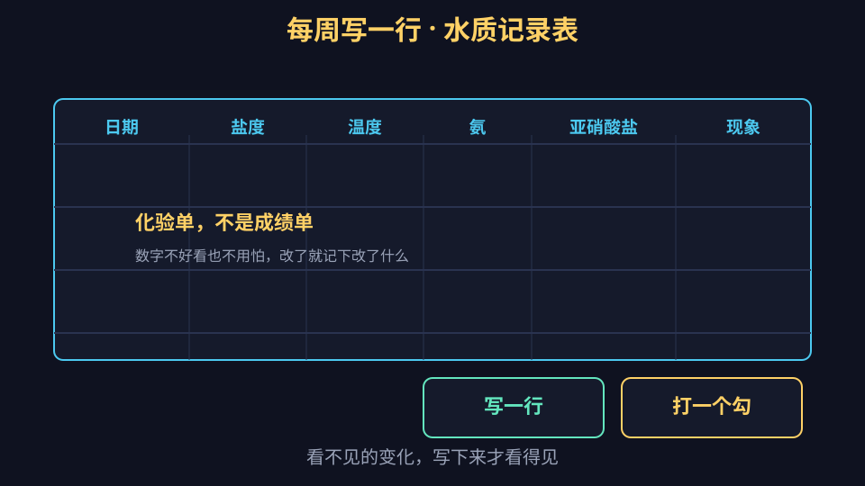
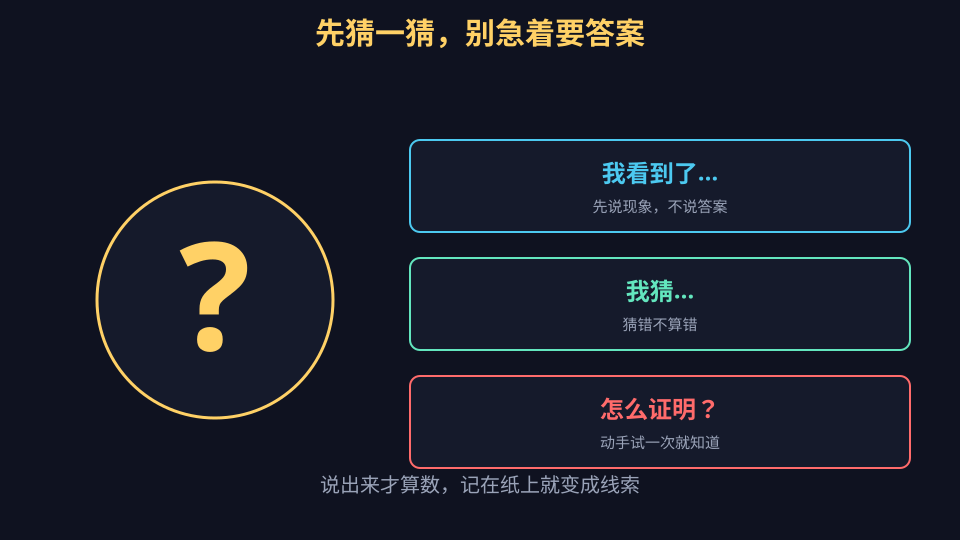
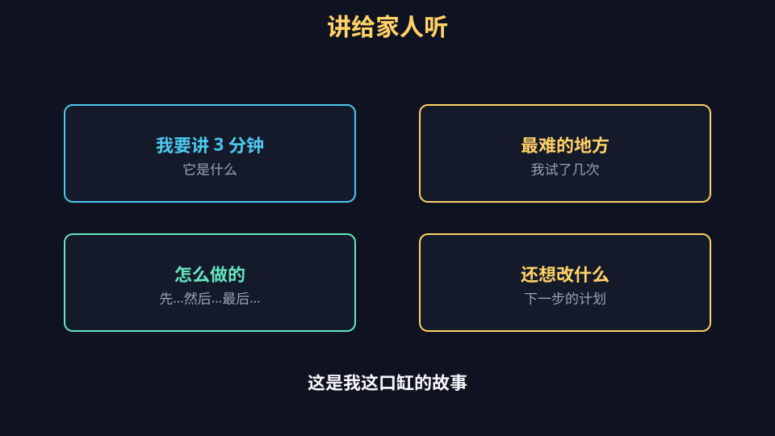
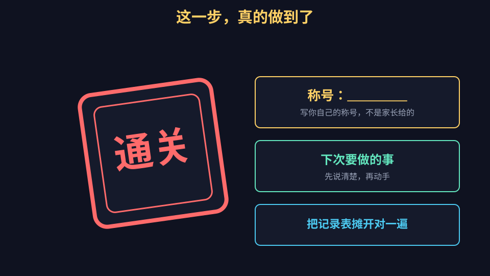

<!--
40cm 背滤海缸（小丑鱼练手版）· 第 5 课课件
构建：python3 .trae/skills/stem-project-onboarding/scripts/build_slides.py projects/nano-reef-40/docs/儿童课程/*/课件.md --strict
-->

<!-- layout: title -->
# 每周体检

今天你来当缸的医生
<!-- notes: 开场 30 秒。今天是最后一课，孩子要独立做完四步。 -->

---
<!-- layout: image -->
## 先看一样东西

<!-- notes: 看 10 秒，问"哪一步最重要"。其实四步都不能少。 -->

---
<!-- layout: big -->
## 猜一猜
水少了，补什么？
<!-- notes: 先猜。答案是只补纯水——跑掉的是水，盐还在缸里。 -->

---
## 体检四步
1. 测盐度
2. 量温度
3. 换 5 升水
4. 填记录表

<!-- notes: 四步固定顺序，做久了就成了习惯。每周固定同一天做。 -->

---
<!-- layout: image -->
## 为什么只补纯水

蒸发带走水，盐留在缸里
<!-- notes: 补盐水会越补越咸。用补水桶专门装纯水，别和配海水搞混。 -->

---
## 动手（3 步）
1. 抽出 5 升旧水
2. 倒进新配的海水
3. 数字写进表

<!-- notes: 换水量 = 系统水量 × 10%。40 方小缸约 5 升，量杯量准。 -->

---
<!-- layout: image -->
## 记录表长这样

<!-- notes: 每周一行，数字不许空。漏测写"缺"，不要补编数字。 -->

---
<!-- layout: big -->
## 通关条件
四步做完 + 表填满 = 过关
<!-- notes: 孩子自己判断做完没。做完就盖章，这是最后一枚章。 -->

---
<!-- layout: two-col -->
### 我们发现的
- 盐度一直稳在 1.025
- 珊瑚比上周开得大
### 记下的线索
- 有次补了盐水，盐度升到 1.029

<!-- notes: 收尾 3 问。重点问"下周想改哪一件事"。 -->

---
<!-- layout: image -->
## 讲给别人听

它是什么、怎么做的、最难在哪
<!-- notes: 按展示脚本讲 3 分钟。家长只计时，听完问一个问题。 -->

---
<!-- layout: title -->
# 恭喜毕业
你现在是「缸主」

<!-- notes: 集满 5 枚章，发「缸主」称号。鼓励他把缸讲给家人听。 -->
